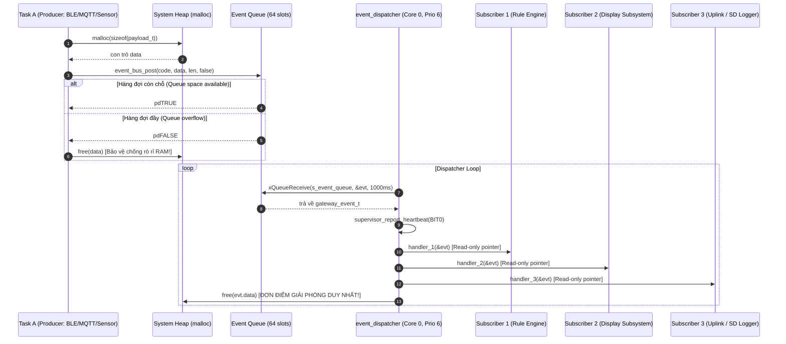
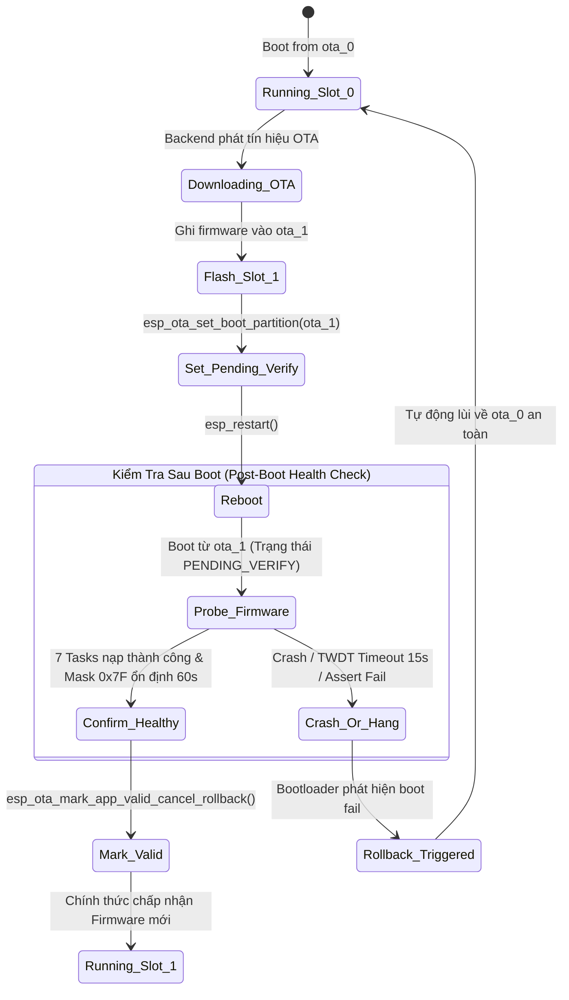

# Kiến Trúc Tổng Quan và Môi Trường Thực Thi (System Overview & Runtime Architecture)

- **Dự án:** Smart Clock as Edge IoT Gateway
- **Tài liệu tham chiếu gốc (Frozen):** [fsd-smart-clock-gateway.md](file:///home/chien/ai-workspace/qwen-test/fsd-smart-clock-gateway.md)
- **Mã nguồn thực thi:** [firmware/main/main.c](file:///home/chien/ai-workspace/qwen-test/firmware/main/main.c), [firmware/main/event_bus.c](file:///home/chien/ai-workspace/qwen-test/firmware/main/event_bus.c), [firmware/main/supervisor.c](file:///home/chien/ai-workspace/qwen-test/firmware/main/supervisor.c)
- **Truy vết yêu cầu kỹ thuật:** `Traces to: FR-EVT-01 / FR-SUP-01 / FR-SUP-02 / KPI-BOOT-01 / NFR-PERF-06 / NFR-RES-01 / NFR-REL-01 / M01 / M17`

---

## 1. Kiến Trúc 2 Lõi (Dual-Core Xtensa LX7 @ 160MHz)

Smart Clock Gateway sử dụng vi điều khiển Espressif ESP32-S3 với vi kiến trúc Xtensa Dual-Core 32-bit LX7 hoạt động ở tần số danh định **160 MHz** (có khả năng boost lên 240 MHz). Nhằm giải quyết triệt để bài toán xung đột tài nguyên giữa các tác vụ thời gian thực (Real-time I/O) và ngăn ngừa hiện tượng nghẽn I/O mạng (Network / SD Card blocking), hệ thống phân định ranh giới cứng giữa hai nhân:

```mermaid
flowchart TB
    subgraph ESP32S3["ESP32-S3 SoC (Xtensa Dual-Core LX7 @ 160MHz)"]
        subgraph CORE0["Core 0: Real-Time, I/O & Automation Domain"]
            SUP["supervisor_task (Prio 7, HW TWDT 15s)"]
            EVT["event_dispatcher (Prio 6, Queue 64 slots)"]
            BLE["ble_scan_task (Prio 5, NimBLE Passive Observer)"]
            SCH["scheduler_task (Prio 4, DS3231 RTC / Alarms)"]
            DSP["display_task (Prio 3, OLED SSD1327 / 1 FPS)"]
            REL["relay_controller & rule_engine (Callback Context)"]
        end

        subgraph INTERCORE["Cơ Chế Liên Nhân (Inter-Core Interconnect)"]
            EB_QUEUE[("FreeRTOS Queue: s_event_queue (64 slots)")]
            NOTIFY["Direct-to-Task Notifications (Zero-Lock)"]
            SHARED_RAM["Internal 512KB SRAM Heap (Zero PSRAM Bloat)"]
        end

        subgraph CORE1["Core 1: Network, Storage & Management Domain"]
            UPLINK["uplink_task (Prio 5, Wi-Fi STA, MQTT Client QoS 1)"]
            SDLOG["sd_log_task (Prio 4, SPI FATFS MicroSD Logger)"]
            CLI["serial_cli_task (Prio 2, UART0 Rescue Console)"]
            WEB["web_server / DNS (Prio 2, SoftAP Captive Portal)"]
            TCPIP["lwIP Network Stack & Wi-Fi Driver Tasks"]
        end
    end

    CORE0 <--> INTERCORE
    INTERCORE <--> CORE1

    classDef core0 fill:#e1f5fe,stroke:#0288d1,stroke-width:2px;
    classDef core1 fill:#fff3e0,stroke:#f57c00,stroke-width:2px;
    classDef inter fill:#f3e5f5,stroke:#7b1fa2,stroke-width:2px;
    class CORE0,SUP,EVT,BLE,SCH,DSP,REL core0;
    class CORE1,UPLINK,SDLOG,CLI,WEB,TCPIP core1;
    class INTERCORE,EB_QUEUE,NOTIFY,SHARED_RAM inter;
```



### 1.1 Nguyên Lý Phân Phối Nhân (Core Affinity Rationale)

1. **Core 0 — Real-Time, Wireless BLE, Actuator & Giám Sát:**
   - **Cách ly độ trễ (Latency Isolation):** Các tác vụ như quét gói tin BLE, cập nhật màn hình OLED, kích hoạt rơ-le và đánh giá luật tự động hóa yêu cầu phản hồi tất định (< 50ms theo `NFR-PERF-01`). Việc cố định các tác vụ này trên Core 0 bảo vệ chúng khỏi hiện tượng nghẽn dòng do lwIP stack hoặc I/O ghi thẻ nhớ gây ra.
   - **Đồng bộ hóa nhịp tim giám sát (Task Supervisor):** [firmware/main/supervisor.c](file:///home/chien/ai-workspace/qwen-test/firmware/main/supervisor.c) chạy ở Priority 7 trên Core 0 để quản lý Task Watchdog (TWDT) cấp phần cứng, đảm bảo bắt kịp mọi hiện tượng treo CPU hoặc starvation.

2. **Core 1 — Mạng Wi-Fi, MQTT, Thẻ Nhớ SD & Console CLI:**
   - **Xử lý tác vụ có độ trễ không tất định (Non-deterministic I/O):** Thao tác ghi thẻ nhớ SD (`sd_log_task`) thông qua SPI bus có thể trễ đột ngột từ **100ms đến 300ms** khi controller nội tại của thẻ SD thực hiện Garbage Collection hoặc block erase. Đưa `sd_log_task` sang Core 1 triệt tiêu nguy cơ giật lag hiển thị OLED hoặc trễ phản hồi nút bấm trên Core 0.
   - **Tối ưu hóa lwIP và kết nối không dây:** Wi-Fi Station stack, MQTT client ([firmware/main/uplink.c](file:///home/chien/ai-workspace/qwen-test/firmware/main/uplink.c)) và Captive Portal HTTP Web Server đều chạy trên Core 1, tận dụng tối đa băng thông mà không can thiệp vào vòng quét BLE trên Core 0.

3. **Kỷ luật Ponytail về Giao tiếp Liên nhân (Ponytail Inter-Core Discipline):**
   - *YAGNI & Tận dụng FreeRTOS*: Tuyệt đối không tạo cơ chế đồng bộ hóa liên nhân tự chế (custom spinlocks, cross-core shared memory buffers tự viết, hay polymorphic vtables).
   - Toàn bộ giao tiếp liên nhân được tinh giản về 2 cơ chế chuẩn có sẵn của FreeRTOS:
     1. Hàng đợi `s_event_queue` (64 slots): FreeRTOS queue tích hợp sẵn spinlock an toàn đa lõi (SMP-safe).
     2. Task Notifications (`vTaskNotifyGive` / `ulTaskNotifyTake`): Dùng trực tiếp cho tín hiệu ngắt nút bấm khẩn cấp, tiêu tốn 0 byte RAM bổ sung và zero-lock.
   - `/* ponytail: Chỉ dùng FreeRTOS Queue và Task Notifications chuẩn của ESP-IDF; từ chối mọi lớp trừu tượng liên nhân tự chế hoặc mutex lồng nhau để loại bỏ 100% nguy cơ Deadlock và Priority Inversion giữa 2 cores. */`

---

## 2. Bảng Đặc Tả 7 Production Tasks (Mask 0x7F)

Hệ thống chuẩn hóa danh mục **7 tác vụ sản xuất (Production Tasks)** chịu sự giám sát trực tiếp của Task Supervisor theo cơ chế Heartbeat Bitmask `0x7F` (FSD §4.13.2 / `FR-SUP-01` / `FR-SUP-02`):

| Bitmask | Tên Task (C Symbol) | FreeRTOS Priority | Core Affinity | Stack Size (Bytes) | Chu Kỳ Báo Nhịp Tim | Timeout Xử Lý | Nhiệm Vụ Cụ Thể Trong Hệ Thống |
|---|---|:---:|:---:|:---:|:---:|:---:|---|
| **Bit 0** (`1<<0`) | `event_dispatcher` | 6 | Core 0 | 4096 B | $\le 1000$ ms | 15.0 s | Nhận bản tin từ `s_event_queue` (64 slots), duyệt danh bạ subscriber, gọi callback và thực hiện **đơn điểm giải phóng bộ nhớ `free()`**. |
| **Bit 1** (`1<<1`) | `ble_scan_task` | 5 | Core 0 | 4096 B | 1000 ms | 15.0 s | Điều khiển NimBLE Passive Observer quét beacon `0x181A` / BTHome V2, chống bão gói tin, đóng gói `ble_telemetry_t` gửi vào Event Bus. |
| **Bit 2** (`1<<2`) | `uplink_task` | 5 | Core 1 | 4096 B | 1000 ms | 15.0 s | Quản lý vòng đời Wi-Fi Station, MQTT Client (QoS 1), xử lý Exponential Backoff, điều phối Backfill Batch từ thẻ nhớ lên Cloud. |
| **Bit 3** (`1<<3`) | `sd_log_task` | 4 | Core 1 | 4096 B | $\le 1000$ ms | 15.0 s | Quản lý filesystem FATFS trên MicroSD, ghi nhật ký CSV, duy trì hàng đợi nhị phân ngoại tuyến `sync_queue.bin` và thực hiện `f_sync()`. |
| **Bit 4** (`1<<4`) | `scheduler_task` | 4 | Core 0 | 4096 B | 1000 ms | 15.0 s | Đọc đồng hồ RTC DS3231 mỗi 1000ms, kiểm tra danh sách lịch biểu / báo thức từ `schedule.json`, thực hiện Rollover Guard & Catch-up. |
| **Bit 5** (`1<<5`) | `display_task` | 3 | Core 0 | 4096 B | 1000 ms | 15.0 s | Render giao diện OLED SSD1327 128x128 4-bit Grayscale ở tốc độ 1 FPS, xử lý chuyển trang hiển thị và trạng thái chuông báo thức. |
| **Bit 6** (`1<<6`) | `serial_cli_task` | 2 | Core 1 | 4096 B | 1000 ms | 15.0 s | Tiếp nhận lệnh qua USB UART0 (115200 bps, timeout 1s non-blocking), thực hiện cứu hộ cấu hình, chẩn đoán bộ nhớ và debug ngoại vi. |

> [!NOTE]
> **Tác vụ giám sát tối cao (Auxiliary Supervisor Task):**
> `supervisor_task` ([firmware/main/supervisor.c](file:///home/chien/ai-workspace/qwen-test/firmware/main/supervisor.c)) chạy ở **Priority 7 trên Core 0**, stack **3072 Bytes**. Task này không thuộc mask 0x7F vì đóng vai trò quan sát viên: liên tục nhận diện cờ từ 7 task trên, xóa cờ về 0 mỗi chu kỳ 1000ms, và tiếp thức ăn (feed) cho Hardware Task Watchdog Timer (TWDT) của ESP-IDF.

---

## 3. Kiến Trúc Central Event Bus

Hệ thống áp dụng kiến trúc hướng sự kiện trung tâm (Centralized Event Bus) nhằm triệt tiêu hoàn toàn sự phụ thuộc trực tiếp (Tight Coupling) giữa các phân hệ:



### 3.1 Quy Tắc Cấp Phát và Thu Hồi Bộ Nhớ Tuyệt Đối (`Single-Point free()`)

1. **Producer sở hữu `malloc()`:** Phân hệ phát sinh sự kiện (vd: [firmware/main/ble_adapter.c](file:///home/chien/ai-workspace/qwen-test/firmware/main/ble_adapter.c) khi nhận telemetry) thực hiện cấp phát bộ nhớ heap động.
2. **Dispatcher sở hữu `free()`:** Các subscriber tuyệt đối **KHÔNG ĐƯỢC PHÉP** gọi `free(evt->data)` hay lưu trữ con trỏ `evt->data` để dùng sau. Sau khi hoàn thành việc gọi tuần tự các hàm callback đã đăng ký, `event_dispatcher` là thực thể duy nhất gọi `free(evt.data)`.
3. **Phòng chống nghẽn hàng đợi (Queue Overflow Drop Policy):**
   - Kích thước hàng đợi được cấu hình cố định: `EVENT_BUS_QUEUE_LEN = 64` slots ([firmware/main/event_bus.h](file:///home/chien/ai-workspace/qwen-test/firmware/main/event_bus.h#L132)).
   - Khi gọi `event_bus_post()`, nếu hàng đợi bị đầy (trả về `pdFALSE`), hàm này **lập tức giải phóng `free(data)` ngay tại chỗ**, ghi nhận log cảnh báo và trả về lỗi, đảm bảo không bao giờ xảy ra rò rỉ bộ nhớ (Memory Leak) ngay cả khi hệ thống chịu bão bản tin (Burst storm).
4. **Nguyên tắc không gây nghẽn Dispatcher (Non-Blocking Dispatcher Contract):**
   - Mọi subscriber callback đăng ký qua `event_bus_register_handler()` bắt buộc phải thực thi tức thời (< 5ms).
   - Tuyệt đối cấm gọi `vTaskDelay()`, các lệnh I/O đồng bộ (ghi flash, đọc ghi SD, socket network), hoặc chờ Semaphore vô hạn trong callback. Mọi tác vụ nặng phải đẩy vào hàng đợi riêng của task đó (vd: `s_sd_log_queue`).
5. **Bảng Đăng Ký Handler Tĩnh (Static Handler Array Optimization):**
   - Thay vì cấp phát danh sách liên kết động (linked-list) cho từng subscriber, hệ thống sử dụng mảng tĩnh phẳng: `s_handlers[EVT_MAX_CODES][EVENT_BUS_MAX_HANDLERS]`.
   - `/* ponytail: Sử dụng bảng con trỏ hàm 2 chiều cố định trong BSS thay vì heap-allocated linked list. Với tối đa 4 handlers/event, cấu trúc này tiêu tốn dưới 500 bytes RAM, loại bỏ 100% rủi ro phân mảnh heap và overhead cấp phát động khi khởi động. */`

---

## 4. Phân Vùng Flash, Memory Map & Chiến Lược OTA Rollback

### 4.1 Bản Đồ Phân Vùng Flash Chuẩn 8MB SPI Flash ([partitions.csv](file:///home/chien/ai-workspace/qwen-test/firmware/partitions.csv))

Dự án được chuẩn hóa theo bảng phân vùng thực tế trên phần cứng ESP32-S3 với dung lượng chuẩn **8 MB SPI Flash** (tương thích cả module 8MB và 16MB mà không lãng phí):

| Tên Partition | Type | SubType | Offset | Kích Thước (Bytes) | Dung Lượng | Chức Năng & Nội Dung Lưu Trữ |
|---|---|---|---|---|---|---|
| `nvs` | data | nvs | `0x9000` | `0x6000` | 24 KB | Lưu trữ thông số Wi-Fi, MQTT Broker URI, Timezone, Device Whitelist NVS. |
| `otadata` | data | ota | `0xF000` | `0x2000` | 8 KB | Quản lý slot khởi động OTA hiện hành và cờ kiểm định trạng thái Rollback. |
| `phy_init` | data | phy | `0x11000` | `0x1000` | 4 KB | Dữ liệu cân chỉnh RF vô tuyến cấp thấp (Wi-Fi/Bluetooth calibration). |
| `factory` | app | factory | `0x20000` | `0x200000` | 2048 KB (2 MB) | Firmware xuất xưởng ban đầu, dự phòng khôi phục cài đặt gốc. |
| `ota_0` | app | ota_0 | `0x220000` | `0x200000` | 2048 KB (2 MB) | Phân vùng nạp Firmware ứng dụng hoạt động chính (Slot 0). |
| `ota_1` | app | ota_1 | `0x420000` | `0x200000` | 2048 KB (2 MB) | Phân vùng nạp Firmware ứng dụng đối xứng phục vụ cập nhật OTA (Slot 1). |
| `storage` | data | spiffs | `0x620000` | `0x200000` | 2048 KB (2 MB) | Phân vùng LittleFS/SPIFFS cục bộ (`config.json`, `rules.json`, `schedule.json`). |

> [!NOTE]
> `/* ponytail: Bảng phân vùng khớp 100% với firmware/partitions.csv (tổng 8.125 MB). Loại bỏ hoàn toàn phân vùng phantom reserved 7.87MB theo nguyên tắc YAGNI; bảo đảm firmware nạp và chạy hoàn hảo trên mọi module ESP32-S3 WROOM chuẩn 8MB Flash. */`

### 4.2 Ngân Sách Bộ Nhớ Nội Bộ 512 KB Internal SRAM (Zero PSRAM Dependency)

Hệ thống được thiết kế vận hành độc lập **100% trong 512 KB Internal SRAM** của ESP32-S3 mà không cần gắn thêm chip Octal PSRAM ngoài (BOM = $0, tiết kiệm điện năng và loại bỏ độ trễ cache miss):

```
┌────────────────────────────────────────────────────────────────────────────────────────┐
│                        ESP32-S3 Internal SRAM (512 KB) Budget                          │
├────────────────────────────┬─────────────────────────────┬─────────────────────────────┤
│   DMA Buffers & Wi-Fi/BT   │      Task Stacks & Data     │      Free Dynamic Heap      │
│          (~140 KB)         │           (~39 KB)          │          (~250 KB)          │
├────────────────────────────┼─────────────────────────────┼─────────────────────────────┤
│ - Wi-Fi Station/AP drivers │ - 7 Tasks x 4KB = 28 KB     │ - Dynamic Event Payloads    │
│ - NimBLE Controller BT RAM │ - 1 Supervisor Task = 3 KB  │ - cJSON transient parse buf │
│ - I2C/SPI DMA Transmit Buf │ - Framebuffer SSD1327 = 8 KB│ - lwIP TCP Sockets & Mbufs  │
└────────────────────────────┴─────────────────────────────┴─────────────────────────────┘
```

- **OLED Framebuffer (8 KB):** Cấp phát static mảng 8192 Bytes ngay trên Internal SRAM. Nhờ đó, driver SSD1327 truyền dữ liệu qua I2C DMA tốc độ 400kHz tức thời mà không cần qua giao diện SPI PSRAM chậm chạp.
- **Hàng đợi Event Bus (64 slots):** Chỉ chiếm $64 \times 16 = 1024$ Bytes trên Internal SRAM.
- `/* ponytail: YAGNI & Tiết kiệm chi phí - Loại bỏ hoàn toàn ngoại vi PSRAM 8MB. Toàn bộ firmware chạy gọn gàng trong 512KB SRAM nội; heap khả dụng ~250KB đủ đáp ứng cùng lúc 64 event bus payloads, bộ đệm cJSON và kết nối MQTT/Web Server. */`

### 4.3 Chiến Lược Cập Nhật Firmware OTA Hai Khe (Dual-Slot Rollback)

Hệ thống áp dụng cơ chế **A/B Dual-Slot OTA Update** chuẩn ESP-IDF với khả năng tự động khôi phục (Automatic Rollback):



1. Firmware mới được tải qua Wi-Fi và ghi từng block vào slot đối xứng (`ota_1`).
2. Bootloader đánh dấu trạng thái phân vùng mới là `ESP_OTA_IMG_PENDING_VERIFY`.
3. Sau khi khởi động lại, `supervisor_task` bắt đầu chu kỳ đếm an toàn **60 giây**. Nếu toàn bộ 7 production tasks đều báo danh Heartbeat bình thường, mạng kết nối ổn định và không phát sinh Kernel Panic, hệ thống gọi hàm `esp_ota_mark_app_valid_cancel_rollback()` để cố định bản cập nhật.
4. Nếu xảy ra hiện tượng Crash Loop, TWDT kích hoạt reset hoặc task bị deadlock trong giai đoạn kiểm định, chip ESP32-S3 tự động hoàn nguyên (Rollback) về phân vùng đang chạy ổn định trước đó.

---

## 5. Vòng Đời Khởi Động và Chế Độ Tự Thích Ứng Ngoại Vi (Dynamic Peripheral Masking)

### 5.1 Quy Chuẩn 16 Bước Khởi Động Hệ Thống (Standardized 16-Step Boot Sequence)

Hệ thống tuân thủ nghiêm ngặt quy trình khởi động 16 bước được quy định tại FSD §4.14 và triển khai thực tế tại [firmware/main/main.c](file:///home/chien/ai-workspace/qwen-test/firmware/main/main.c):

```
[BƯỚC 1]  nvs_flash_init()                   -> Tham số Wi-Fi, System, Timezone
[BƯỚC 2]  event_bus_init()                   -> Khởi tạo Event Queue trung tâm (64 slots)
[BƯỚC 3]  relay_controller_init()            -> Fail-safe phần cứng: Kéo GPIO 15..18 LOW ngay
[BƯỚC 4]  supervisor_init()                  -> Kích hoạt Task Supervisor (Mask 0x7F, TWDT 15s)
[BƯỚC 5]  app_rtc_init()                     -> Khởi tạo RTC DS3231 I2C0 & Nạp TZ ICT-7
[BƯỚC 6]  display_init()                     -> VẼ MÀN HÌNH ĐỒNG HỒ NGAY! (KPI-BOOT-01 < 1.5s)
[BƯỚC 7]  storage_init()                     -> Gắn kết phân vùng LittleFS /storage
[BƯỚC 8]  sd_logger_init()                   -> Gắn kết MicroSD SPI & Chuẩn bị sync_queue.bin
[BƯỚC 9]  config_manager_init()              -> Nạp cấu hình /storage/config.json
[BƯỚC 10] wifi_provisioning_init()           -> Khởi động Wi-Fi STA / SoftAP Captive Portal
[BƯỚC 11] uplink_init()                      -> Khởi tạo MQTT Client (QoS 1, Core 1)
[BƯỚC 12] rule_engine_init()                 -> Nạp rules.json, thiết lập Hysteresis & Safe-Default
[BƯỚC 13] scheduler_init()                   -> Nạp schedule.json, quét lịch biểu & Rollover Guard
[BƯỚC 14] ble_adapter_init()                 -> Khởi tạo NimBLE Stack Passive Scanner (Core 0)
[BƯỚC 15] serial_cli_init()                  -> Mở cổng điều khiển cứu hộ UART0 (115200 baud)
[BƯỚC 16] event_bus_start_dispatcher()       -> BẮT ĐẦU ĐIỀU PHỐI (LUÔN CHẠY SAU CÙNG)
```

### 5.2 Biểu Đồ Trạng Thái Tự Thích Ứng Ngoại Vi (Dynamic Peripheral Masking)

Nhằm đảm bảo thiết bị không bao giờ rơi vào trạng thái "treo hoàn toàn" khi một thành phần phần cứng ngoại vi bị lỗi hoặc chưa cắm, Gateway áp dụng kiến trúc **Tự thích ứng ngoại vi linh hoạt (Degraded Fallback Execution)**:

```mermaid
stateDiagram-v2
    [*] --> Power_On : Cấp nguồn thiết bị
    Power_On --> Hardware_Probe : Khởi tạo chân GPIO & I2C/SPI bus

    state Hardware_Probe {
        Probe_RTC : Thử đọc DS3231 (I2C 0x68)
        Probe_OLED : Thử nhận diện SSD1327 (I2C 0x3C)
        Probe_SD : Thử mount FATFS MicroSD (SPI CS=10)
        Probe_Storage : Mount LittleFS (/storage)
    }

    Hardware_Probe --> Degraded_Check : Tổng hợp trạng thái ngoại vi

    state Degraded_Check {
        Degraded_Check --> RTC_Degraded : DS3231 NACK / Hỏng pin
        Degraded_Check --> OLED_Degraded : OLED NACK / Mất nguồn màn hình
        Degraded_Check --> SD_Degraded : Chưa cắm thẻ SD / Thẻ hỏng
        Degraded_Check --> Storage_Degraded : Corrupt LittleFS
    }

    RTC_Degraded --> Action_RTC : rtc_is_valid() = false. Tạm dừng Alarm. Chờ NTP qua Wi-Fi
    OLED_Degraded --> Action_OLED : Chuyển toàn bộ output cảnh báo ra Serial UART0 & Web
    SD_Degraded --> Action_SD : Kích hoạt RAM Ringbuffer Fallback (50 bản tin). Thử mount lại mỗi 10s
    Storage_Degraded --> Action_Storage : Tự động format lại phân vùng và nạp cấu hình mặc định (Safe-Defaults)

    Action_RTC --> System_Operational
    Action_OLED --> System_Operational
    Action_SD --> System_Operational
    Action_Storage --> System_Operational

    System_Operational --> Full_Performance : Tất cả ngoại vi OK (Mặt nạ 0x7F đầy đủ)
    System_Operational --> Degraded_Running : Hoạt động ở chế độ thích ứng an toàn
```

- **Mục tiêu KPI-BOOT-01:** Hiển thị màn hình đồng hồ được vẽ trong vòng **< 1.5 giây** từ lúc bật nguồn. Nếu thẻ nhớ MicroSD bị treo hoặc mạng Wi-Fi không phản hồi, tiến trình hiển thị màn hình (Bước 6) vẫn độc lập tuyệt đối và hiển thị đúng giờ ngay lập tức nhờ RTC DS3231.
- **Tính khả thi thực tế:** Đã được kiểm chứng thông qua Journey Test `JRN-01` và các bài đo hiệu năng trong [testing/test-plan.yaml](file:///home/chien/ai-workspace/qwen-test/testing/test-plan.yaml).
