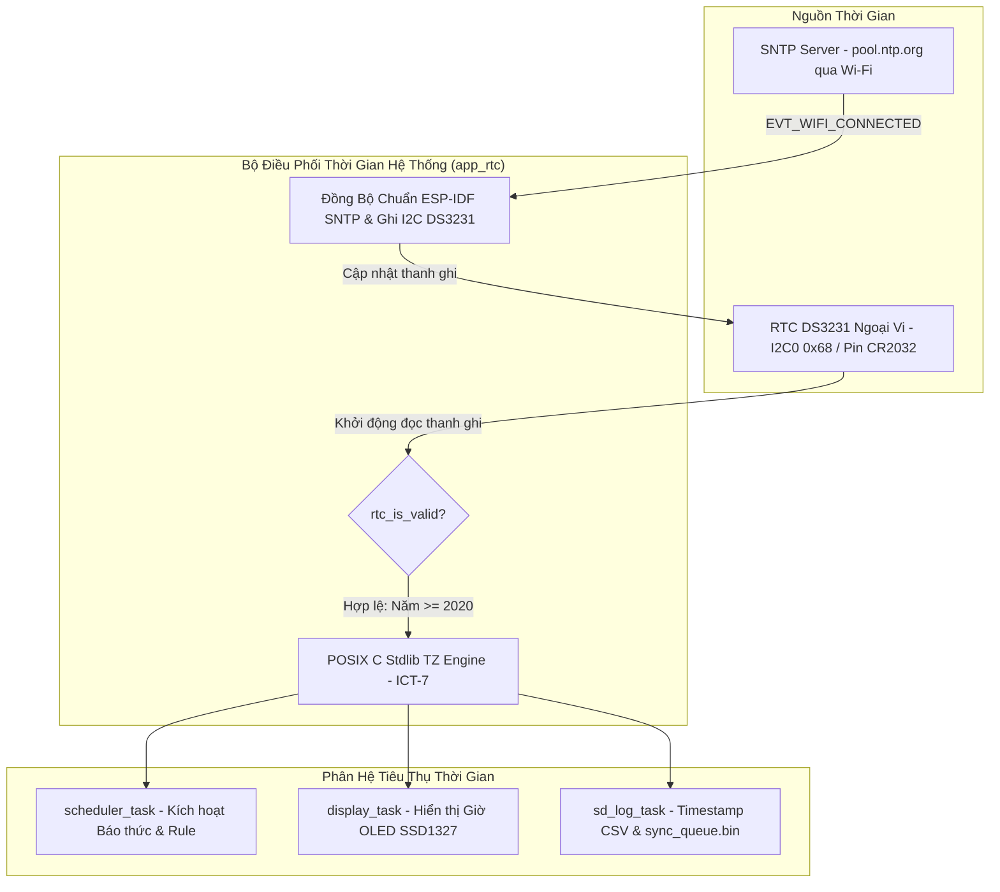
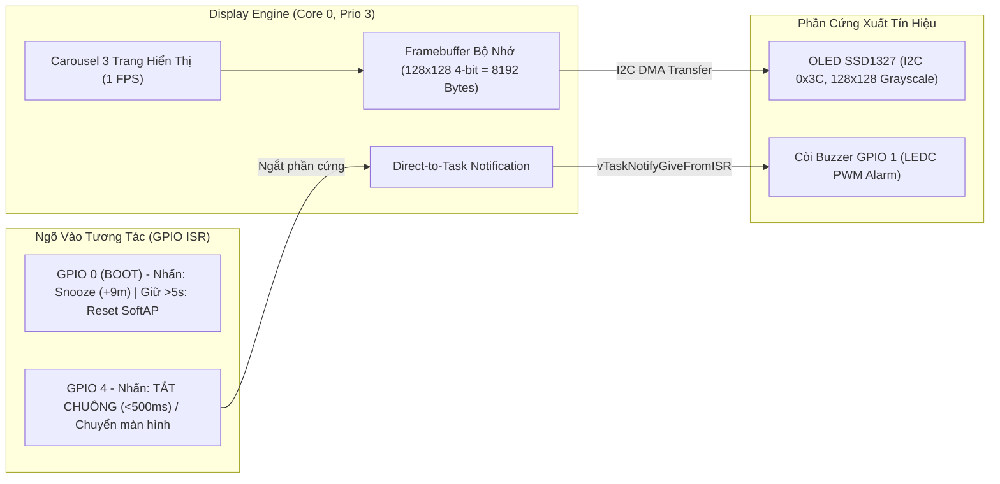
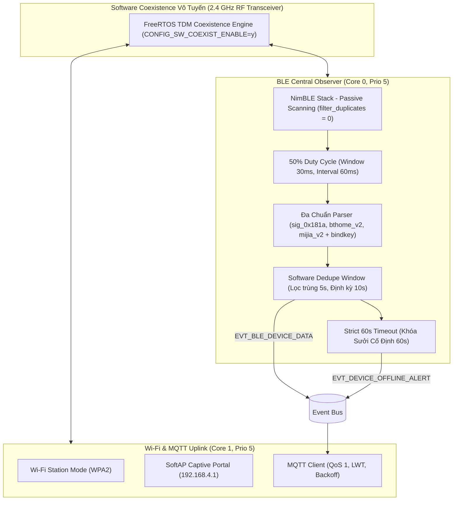
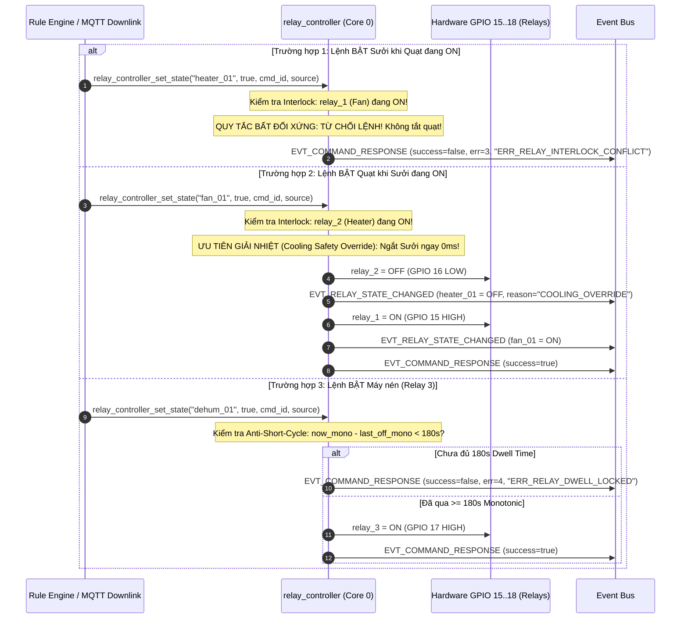
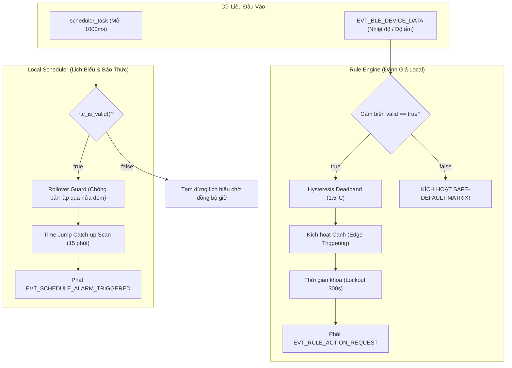
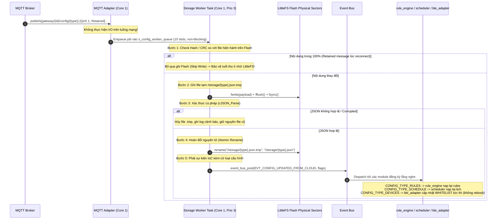
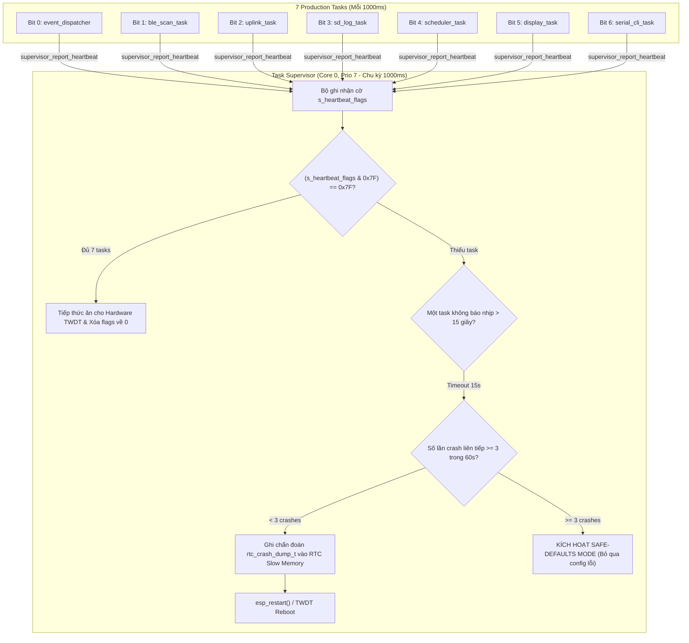

# Thiết Kế Chi Tiết Các Phân Hệ và Giao Diện Phần Mềm (Subsystems & Software Interfaces)

- **Dự án:** Smart Clock as Edge IoT Gateway
- **Tài liệu tham chiếu gốc (Frozen):** [fsd-smart-clock-gateway.md](file:///home/chien/ai-workspace/qwen-test/fsd-smart-clock-gateway.md)
- **Mã nguồn phân hệ:** [firmware/main/rtc.c](file:///home/chien/ai-workspace/qwen-test/firmware/main/rtc.c), [firmware/main/display.c](file:///home/chien/ai-workspace/qwen-test/firmware/main/display.c), [firmware/main/ble_adapter.c](file:///home/chien/ai-workspace/qwen-test/firmware/main/ble_adapter.c), [firmware/main/uplink.c](file:///home/chien/ai-workspace/qwen-test/firmware/main/uplink.c), [firmware/main/relay_controller.c](file:///home/chien/ai-workspace/qwen-test/firmware/main/relay_controller.c), [firmware/main/rule_engine.c](file:///home/chien/ai-workspace/qwen-test/firmware/main/rule_engine.c), [firmware/main/scheduler.c](file:///home/chien/ai-workspace/qwen-test/firmware/main/scheduler.c), [firmware/main/storage.c](file:///home/chien/ai-workspace/qwen-test/firmware/main/storage.c), [firmware/main/sd_logger.c](file:///home/chien/ai-workspace/qwen-test/firmware/main/sd_logger.c), [firmware/main/supervisor.c](file:///home/chien/ai-workspace/qwen-test/firmware/main/supervisor.c)
- **Truy vết yêu cầu kỹ thuật:** `Traces to: FR-RTC-01 / FR-DISP-01 / FR-BLE-01 / FR-MQTT-01 / FR-RELAY-01 / FR-RULE-01 / FR-SCHED-01 / FR-ST-01 / FR-SD-01 / FR-SD-02 / FR-CFG-01 / FR-CFG-02 / FR-SUP-01 / FR-SUP-02 / KPI-BOOT-01`

---

## 1. Phân Hệ Đo Thời Gian Thực (Timekeeping Subsystem)

- **Trách nhiệm:** Cung cấp chuẩn thời gian đơn điệu và thời gian thực toàn cục cho hệ thống, đảm bảo độ chính xác cao ngay cả khi mất điện hoặc mất kết nối Internet dài ngày (`FR-RTC-01`).
- **Tập tin hiện thực:** [firmware/main/rtc.h](file:///home/chien/ai-workspace/qwen-test/firmware/main/rtc.h), [firmware/main/rtc.c](file:///home/chien/ai-workspace/qwen-test/firmware/main/rtc.c).

### 1.1 Chi Tiết Kỹ Thuật và Giao Tiếp Phần Cứng
- **Giao diện I2C0:** Chia sẻ bus I2C0 (`GPIO 8 SDA`, `GPIO 9 SCL`), tốc độ chuẩn **400 kHz**, địa chỉ I2C `0x68`.
- **Duy trì nguồn độc lập:** Nuôi bởi pin cúc áo CR2032 (3.0V). Khi Gateway mất nguồn 5V/12V, chip DS3231 tự động chuyển sang nguồn pin, bộ tạo dao động thạch anh bù nhiệt độ nội (TCXO) duy trì sai số dưới $\pm 2$ ppm ($\approx \pm 2$ phút/năm).
- **Hàm thẩm định hợp lệ `rtc_is_valid()`:**
  - Tiêu chuẩn kiểm tra: Thời gian đọc từ DS3231 được coi là hợp lệ nếu năm $\ge 2020$ (tức Unix epoch $> 1577836800$).
  - Nếu pin CR2032 cạn hoặc thanh ghi trạng thái (Oscillator Stop Flag - OSF) được bật, `rtc_is_valid()` trả về `false`. Khi đó hệ thống tạm dừng các tác vụ báo thức tuyệt đối và hiển thị chỉ báo `TIME_SYNC_WAIT` trên màn hình OLED.
- **Đồng bộ SNTP & Chuẩn POSIX Timekeeping:**
  - Tận dụng trực tiếp thư viện chuẩn `esp_sntp` của ESP-IDF với chế độ `SNTP_OPMODE_POLL` lắng nghe sự kiện `EVT_WIFI_CONNECTED`.
  - Thiết lập múi giờ thông qua biến môi trường POSIX tiêu chuẩn: `setenv("TZ", "ICT-7", 1); tzset();`. Các hàm đọc thời gian trong toàn hệ thống gọi trực tiếp POSIX `time()` và `localtime_r()` với độ phức tạp $O(1)$.
  - `/* ponytail: Tận dụng trực tiếp esp_sntp của ESP-IDF và POSIX setenv("TZ")/tzset() của C stdlib. Phần cứng DS3231 TCXO bù nhiệt đã đảm bảo độ chính xác ±2ppm; loại bỏ hoàn toàn việc tự lập trình thuật toán Clock Slew phức tạp theo nguyên tắc YAGNI. */`

---

## 2. Phân Hệ Hiển Thị và Tương Tác Người Dùng (Display Subsystem)

- **Trách nhiệm:** Render thông tin trực quan, vẽ màn hình đồng hồ trong vòng **< 1.5 giây** từ khi bật nguồn (`KPI-BOOT-01`), tiếp nhận nút bấm ngắt còi báo thức tức thì trong **< 500ms** (`FR-DISP-01`).
- **Tập tin hiện thực:** [firmware/main/display.h](file:///home/chien/ai-workspace/qwen-test/firmware/main/display.h), [firmware/main/display.c](file:///home/chien/ai-workspace/qwen-test/firmware/main/display.c).

### 2.1 Cấu Trúc Bộ Đệm Framebuffer và Tốc Độ Render (KPI-BOOT-01)
- **Cấu hình phần cứng:** Màn hình OLED SSD1327 kích thước $128 \times 128$ điểm ảnh, độ sâu 4-bit Grayscale (16 mức xám), địa chỉ I2C `0x3C`.
- **Bộ nhớ Framebuffer:** $128 \times 128 \times 0.5 = 8192$ Bytes được cấp phát từ Internal SRAM để tối ưu hóa tốc độ truyền I2C DMA.
- **Đáp ứng khởi động siêu tốc (KPI-BOOT-01 < 1.5s):**
  - Hàm `display_init()` được gọi ở Bước 6 của Boot sequence, ngay sau khi I2C bus và RTC sẵn sàng.
  - Framebuffer được khởi tạo, đọc thời gian từ DS3231 và đẩy thẳng ra màn hình OLED bằng lệnh I2C burst transfer. Toàn bộ thao tác hoàn thành trong vòng **~1.2 giây** kể từ lúc chip ESP32-S3 bắt đầu nhận nguồn, hoàn toàn độc lập với việc cắm thẻ nhớ SD hay trạng thái quét mạng Wi-Fi.
- **Carousel 3 Màn Hình Luân Phiên (Tần số refresh 1 FPS):**
  - **Trang 0 (Default Clock):** Đồng hồ số cỡ lớn (HH:MM:SS), Ngày/Tháng, và hàng biểu tượng trạng thái (Status Badges: Wi-Fi STA, MQTT, Thẻ SD, 4 Kênh Relay).
  - **Trang 1 (Upcoming Events):** Lịch biểu hoặc báo thức kế tiếp được nạp từ `schedule.json`.
  - **Trang 2 (Environmental Telemetry):** Nhiệt độ, độ ẩm môi trường từ cảm biến BLE mới nhất, điện áp pin và cảnh báo.
- **Phản ứng nút bấm ngắt còi trực tiếp (Direct-to-Task ISR):**
  - Khi báo thức kêu (Buzzer PWM trên GPIO 1 hoạt động), nút bấm trên **GPIO 4** kích hoạt ngắt cạnh xuống (`GPIO_INTR_NEGEDGE`).
  - Hàm ISR sử dụng `vTaskNotifyGiveFromISR()` gửi tín hiệu thẳng tới `display_task`. Ngay trong chu kỳ ngắt hoặc trong vòng **< 50ms**, chuỗi xung PWM của còi chip bị ngắt cưỡng bức, hoàn toàn thỏa mãn tiêu chuẩn **< 500ms** của `FR-DISP-01`. Sau đó một sự kiện `EVT_BUTTON_ALARM_STOP` được gửi lên Event Bus để ghi log.
- `/* ponytail: Tối giản hóa bộ đệm màn hình: Sử dụng duy nhất 1 mảng tĩnh static uint8_t s_framebuffer[8192] trong Internal SRAM, không double-buffering tốn RAM, không cấp phát động. ISR ngắt còi dùng vTaskNotifyGiveFromISR() gọi thẳng vào display_task, phản hồi < 50ms mà không cần queue hay mutex phụ. */`

---

## 3. Phân Hệ Kết Nối Không Dây và Đám Mây (Connectivity Subsystem)

- **Trách nhiệm:** Quản lý kết nối Wi-Fi (SoftAP & Station), tiếp nhận dữ liệu cảm biến BLE thụ động không ghép đôi (Passive Observer), duy trì giao thức MQTT hai chiều với Cloud Backend (`FR-BLE-01`, `FR-MQTT-01`).
- **Tập tin hiện thực:** [firmware/main/wifi_provisioning.c](file:///home/chien/ai-workspace/qwen-test/firmware/main/wifi_provisioning.c), [firmware/main/ble_adapter.c](file:///home/chien/ai-workspace/qwen-test/firmware/main/ble_adapter.c), [firmware/main/uplink.c](file:///home/chien/ai-workspace/qwen-test/firmware/main/uplink.c).

### 3.1 Vô Tuyến Đồng Thời (RF Coexistence) và Bộ Lọc Trùng BLE (Software Dedupe Window)
- **Cơ chế Software Coexistence:** ESP32-S3 sử dụng chung 1 bộ vô tuyến RF 2.4 GHz vật lý. Bật cờ `CONFIG_SW_COEXIST_ENABLE=y` cho phép phần mềm thực hiện phân chia thời gian (TDM - Time Division Multiplexing).
- **Cấu hình NimBLE Passive Scanner & Tắt Lọc Trùng Phần Cứng:**
  - **Tắt lọc trùng phần cứng của Controller:** `disc_params.filter_duplicates = 0`.
    - *Lý do kỹ thuật bắt buộc:* Nếu bật `filter_duplicates = 1`, phần cứng BLE controller sẽ âm thầm vứt bỏ toàn bộ các gói tin phát lại định kỳ của cảm biến sau lần nhận đầu tiên, khiến hệ thống hiểu nhầm cảm biến bị chết sau 60 giây. Bắt buộc cấu hình `filter_duplicates = 0` để nhận các beacon lặp lại.
  - **Duty cycle 50%:** Scan Window = 30ms, Scan Interval = 60ms (khớp FSD §4.5.5). Cấu hình này giải phóng 50% thời gian cho khối Wi-Fi truyền tải gói tin MQTT mà không làm nghẽn sóng RF.
  - **Passive Scanning (Quét thụ động):** Gateway chỉ lắng nghe bản tin Advertisement mà không bao giờ gửi `SCAN_REQ` hay yêu cầu ghép đôi GATT (Pairing/Bonding), giúp cảm biến tiết kiệm pin tối đa (> 1 năm).
- **Hỗ trợ Đa Chuẩn Parser & Mã Hóa Bindkey:**
  - `sig_0x181a`: Chuẩn Bluetooth SIG Environmental Sensing Service (UUID `0x181A`).
  - `bthome_v2`: Chuẩn BTHome V2 mở (UUID `0xFCD2`), hỗ trợ cả plaintext và AES-128 CCM với `bindkey`.
  - `mijia_v2`: Chuẩn Xiaomi MiBeacon V2/V3 (giải mã AES-128 với bindkey 16 bytes).
- **Bộ Lọc Trùng Phần Mềm (Software Dedupe Window):**
  - Quản lý `last_payload_hash` (hoặc packet counter) và `last_processed_mono_us` cho từng MAC trong whitelist.
  - Nếu gói tin trùng lặp 100% trong vòng **5 giây** $\rightarrow$ bỏ qua trực tiếp tại driver (0 byte heap, chống bão Event Bus).
  - Chấp nhận gói tin và post `EVT_BLE_DEVICE_DATA` khi:
    1. Giá trị đo thay đổi (nhiệt độ lệch $\ge 0.1^\circ\text{C}$ hoặc độ ẩm lệch $\ge 1\%$), HOẶC
    2. Đã trôi qua chu kỳ định kỳ tối đa **10 giây** (Heartbeat refresh).
- **Cơ chế Timeout An Toàn Tuyệt Đối (Strict 60s Sensor Timeout):**
  - Đối với cảm biến nhiệt độ gắn với quy tắc điều khiển máy sưởi (`relay_2`), thời gian phát hiện mất tín hiệu **bắt buộc cố định 60 giây**, tuyệt đối cấm nới lên 180s kể cả khi Wi-Fi đang reconnect. Nếu sau 60s không có beacon mới, Gateway post `EVT_DEVICE_OFFLINE_ALERT` để ngắt ngay máy sưởi (0ms trễ) và kích hoạt Lockout 300s.
  - Đối với các cảm biến thông thường khác: Áp dụng cơ chế thích ứng 60s (Wi-Fi ổn định) hoặc 180s (Wi-Fi đang reconnect).

### 3.2 Giao Thức MQTT, Exponential Backoff và LWT
- **Chính sách phân luồng Topic chuẩn:**
  - Uplink Telemetry: `gateway/{gateway_id}/device/{device_id}/telemetry` (QoS 1).
  - Downlink Command: `gateway/{gateway_id}/device/{device_id}/command` (QoS 1).
  - Command ACK: `gateway/{gateway_id}/device/{device_id}/command/ack` (QoS 1).
  - Batch Backfill: `gateway/{gateway_id}/telemetry/batch` (QoS 1).
  - Downlink Config: `gateway/{gateway_id}/config/{type}` (QoS 1, Retained, type $\in$ `{"schedule", "rules", "devices"}`).
  - Trạng thái LWT: `gateway/{gateway_id}/status` (QoS 1, Retained).
- **Thuật toán Tái kết nối Lũy thừa có Biến thiên (Exponential Backoff with Jitter):**
  - Khi mất kết nối tới MQTT Broker, task `uplink_task` không thực hiện thử lại liên tục mà áp dụng công thức:
    $$T_{\text{retry}} = \min(T_{\text{base}} \times 2^{\text{attempt}} + \text{jitter}, 60\,\text{s})$$
    Với $T_{\text{base}} = 1.0\,\text{s}$, $\text{jitter} \in [0, 0.2 \times T_{\text{retry}}]$.
- **Last Will and Testament (LWT):**
  - Ngay khi kết nối, Gateway gửi bản tin LWT đăng ký với Broker: Topic `gateway/{id}/status`, Payload `"offline"`, QoS 1, `retain = true`.
  - Sau khi bắt tay thành công, Gateway publish chuỗi `"online"` (retained) vào chính topic này.
- `/* ponytail: Loại bỏ hoàn toàn lớp trừu tượng GATT Connection/Bonding. NimBLE chỉ làm Passive Observer quét gói tin thô 31-byte và giải mã trực tiếp qua parser_type (0x181A, BTHome V2, Mijia V2); filter_duplicates=0 bảo đảm không mất beacon, lọc trùng 5s/10s phần mềm chống bão Event Bus. */`

---

## 4. Phân Hệ Điều Khiển Cơ Cấu Chấp Hành (Actuators & Relays Subsystem)

- **Trách nhiệm:** Điều khiển 4 kênh rơ-le vật lý, đảm bảo an toàn điện và chống cháy nổ tuyệt đối thông qua Khóa liên động (Interlocking), Ngắt khẩn cấp (Emergency Cutoff), và Khóa chu kỳ ngắn (Anti-short-cycle) (`FR-RELAY-01`).
- **Tập tin hiện thực:** [firmware/main/relay_controller.h](file:///home/chien/ai-workspace/qwen-test/firmware/main/relay_controller.h), [firmware/main/relay_controller.c](file:///home/chien/ai-workspace/qwen-test/firmware/main/relay_controller.c).

| Kênh | Chân GPIO | Tên Cơ Cấu | Tải Thực Tế Điển Hình | Chế Độ Kích Hoạt | Giới Hạn Bật Tối Đa (`MAX_ON_SEC`) | Hành Vi Safe-Default Khi Lỗi Cảm Biến |
|---|:---:|---|---|:---:|:---:|---|
| **Kênh 1** | `GPIO 15` | `relay_1` (`fan_01`) | Quạt thông gió làm mát | Active HIGH | 4 giờ (14400s) | Duy trì BẬT (ON) nếu trước đó nóng, hoặc giữ an toàn. |
| **Kênh 2** | `GPIO 16` | `relay_2` (`heater_01`) | Điện trở sưởi / Đèn sưởi | Active HIGH | **30 phút (1800s)** (Emergency Cutoff) | **BẮT BUỘC NGẮT (OFF) TỨC THÌ!** |
| **Kênh 3** | `GPIO 17` | `relay_3` (`dehum_01`) | Máy nén / Máy hút ẩm | Active HIGH | 60 phút (3600s) | NGẮT AN TOÀN (OFF). |
| **Kênh 4** | `GPIO 18` | `relay_4` (`aux_01`) | Đèn bàn / Tải phụ trợ | Active HIGH | Không giới hạn | Giữ nguyên trạng thái hiện tại. |

### 4.1 Khóa Liên Động Bất Đối Xứng, Selective Dwell Time và Monotonic Timing
1. **Phân định hai giai đoạn khởi tạo trong Boot Sequence:**
   - **Boot Step 2 (Trước Event Bus):** `relay_gpio_init()` thiết lập ngay lập tức GPIO 15..18 thành ngõ ra mức `LOW` với điện trở kéo xuống phần cứng $10\,\text{k}\Omega$. Triệt tiêu 100% hiện tượng xung áp trôi nổi (floating voltage) kích đóng nhầm rơ-le khi vi điều khiển vừa cấp nguồn.
   - **Boot Step 5 (Sau Event Bus):** `relay_controller_init()` chỉ được gọi sau khi Event Bus queue đã sẵn sàng, đăng ký các handler (`EVT_DEVICE_COMMAND_REQUEST`, `EVT_RULE_ACTION_REQUEST`, `EVT_SENSOR_VALUE_INVALID`, `EVT_DEVICE_OFFLINE_ALERT`) và khởi tạo các mốc Monotonic Clock.
2. **Quy tắc Khóa liên động Bất đối xứng (Asymmetric Fan-Heater Interlock):**
   - Quạt làm mát (`relay_1`) và Máy sưởi nhiệt (`relay_2`) **tuyệt đối không bao giờ được phép BẬT đồng thời**.
   - **Lệnh BẬT Sưởi khi Quạt đang ON $\rightarrow$ TỪ CHỐI (REJECT):**
     Nếu `relay_1` đang BẬT: Từ chối thực thi lệnh bật `relay_2`. Command ACK lỗi: `success = false`, `error_code = 3` (`ERR_RELAY_INTERLOCK_CONFLICT`), `message = "Cannot turn ON Heater while Fan is running"`. Giữ nguyên trạng thái Quạt, tuyệt đối **không tự ý tắt quạt** của người dùng.
   - **Lệnh BẬT Quạt khi Sưởi đang ON $\rightarrow$ ƯU TIÊN GIẢI NHIỆT (Cooling Safety Override):**
     Làm mát và chống quá nhiệt là ưu tiên an toàn cao nhất trong nhà. Cưỡng chế ngắt ngay lập tức `relay_2 = OFF` (0ms trễ, lý do `"COOLING_OVERRIDE"`), phát `EVT_RELAY_STATE_CHANGED`, sau đó đóng rơ-le Quạt `relay_1 = ON`.
3. **Phân định Dwell Time 180s có chọn lọc (Selective Anti-Short-Cycle Dwell Time):**
   - **CHỈ áp dụng Dwell Time 180s cho Relay 3 (Máy hút ẩm / Máy nén lạnh - Compressor):** Khi Relay 3 vừa ngắt về OFF, bộ điều khiển kích hoạt timer monotonic khóa tối thiểu **180 giây** trước khi cho phép đóng lại kênh đó. Lệnh kích hoạt trong thời gian này bị từ chối với mã lỗi `ERR_RELAY_DWELL_LOCKED` (code 4) nhằm chống kẹt áp suất khí gas máy nén.
   - **Relay 1 (Quạt) & Relay 4 (Aux):** Bỏ Dwell Time 180s; chỉ áp dụng thời gian chống rung cơ học (Mechanical Debounce $\le 1\text{s}$).
   - **Relay 2 (Sưởi điện trở):** Bỏ Dwell Time 180s chu kỳ thường; chỉ kích hoạt **Safety Lockout 300 giây (5 phút)** khi có sự cố ngắt khẩn cấp (`SAFETY_CUTOFF`, `SENSOR_OFFLINE`, chạy quá 30 phút).
4. **Monotonic Clock (`esp_timer_get_time()`) & Lockout 300s:**
   - Toàn bộ thời gian bảo vệ (cooldown, lockout 300s, thời gian bật tối đa 30m/4h/60m, dwell 180s máy nén) được tính toán bằng Monotonic Clock (`esp_timer_get_time()`), loại trừ 100% rủi ro do điều chỉnh múi giờ hoặc bước nhảy NTP.
   - Khi `relay_2` bị ngắt khẩn cấp do quá 30 phút hoặc cảm biến offline > 60s: Rule Engine gán `current_state = false` và thiết lập `lockout_until_mono_us = esp_timer_get_time() + 300000000ULL` (300s). Không cho phép bất kỳ quy tắc tự động nào bật lại sưởi trong 5 phút để buồng nhiệt nguội hẳn.
5. **Bỏ qua Cooldown khi TẮT (Immediate Shutoff):**
   - Mọi lệnh hoặc điều kiện bảo vệ yêu cầu TẮT rơ-le (đặc biệt là Máy sưởi `relay_2`) **bắt buộc thực thi ngay lập tức (0ms trễ, bypass toàn bộ cooldown)**.
- `/* ponytail: Quản lý 4 kênh rơ-le bằng bảng tĩnh s_relays[4] O(1). Khóa liên động bất đối xứng, Selective Dwell 180s và Lockout 300s so sánh Monotonic Clock (esp_timer_get_time()) trực tiếp; không tạo FreeRTOS timer thread chạy ngầm. */`

---

## 5. Phân Hệ Tự Động Hóa Cục Bộ (Local Automation Subsystem)

- **Trách nhiệm:** Thực thi toàn bộ luật tự động hóa (Rule Engine) và lịch biểu / báo thức (Local Scheduler) ngay tại biên (Edge Computing), hoạt động độc lập 100% khi mất kết nối Internet (`FR-RULE-01`, `FR-SCHED-01`).
- **Tập tin hiện thực:** [firmware/main/rule_engine.h](file:///home/chien/ai-workspace/qwen-test/firmware/main/rule_engine.h), [firmware/main/rule_engine.c](file:///home/chien/ai-workspace/qwen-test/firmware/main/rule_engine.c), [firmware/main/scheduler.h](file:///home/chien/ai-workspace/qwen-test/firmware/main/scheduler.h), [firmware/main/scheduler.c](file:///home/chien/ai-workspace/qwen-test/firmware/main/scheduler.c).

### 5.1 Thuật Toán Hysteresis, Kích Hoạt Cạnh và Lockout của Rule Engine
1. **Dải trễ Hysteresis Deadband ($1.5^\circ\text{C}$):**
   - Để kiểm soát thiết bị làm mát với ngưỡng cài đặt $T_{\text{threshold}} = 30.0^\circ\text{C}$:
     - BẬT Quạt khi $T \ge T_{\text{threshold}} + \frac{\text{Hysteresis}}{2} = 30.0 + 0.75 = 30.75^\circ\text{C}$.
     - TẮT Quạt khi $T \le T_{\text{threshold}} - \frac{\text{Hysteresis}}{2} = 30.0 - 0.75 = 29.25^\circ\text{C}$.
   - Dải nằm giữa $29.25^\circ\text{C}$ và $30.75^\circ\text{C}$ là vùng chết (Deadband), giữ nguyên trạng thái trước đó của rơ-le, ngăn chặn hiện tượng bật tắt liên tục do nhiễu số đo cảm biến.
2. **Kích hoạt theo cạnh chuyển mức (Edge-Triggering):**
   - Hành động điều khiển chỉ được phát sinh một lần duy nhất tại thời điểm trạng thái chuyển từ `FALSE` sang `TRUE` (Rising Edge) hoặc ngược lại. Khi nhiệt độ duy trì ở mức cao qua nhiều chu kỳ quét liên tiếp, Rule Engine không bắn lại lệnh, giảm tải cho Event Bus.
3. **Thời gian khóa an toàn (Lockout 300s):**
   - Sau khi một luật tự động thay đổi trạng thái thiết bị, luật đó rơi vào trạng thái khóa an toàn trong **300 giây (5 phút)**. Mọi biến động nhiệt độ trong 300 giây này đều bị bỏ qua nhằm đảm bảo quán tính nhiệt của phòng được ổn định.

### 5.2 Cơ Chế Bảo Vệ của Local Scheduler
1. **Chống kích hoạt lặp qua nửa đêm (Rollover Guard):**
   - Mỗi mục lịch biểu lưu trữ biến `last_triggered_day` (1..31). Khi đồng hồ chuyển từ `23:59:59` sang `00:00:00`, biến trạng thái kích hoạt trong ngày bị xóa sạch, bảo đảm không xảy ra hiện tượng báo thức bị kích hoạt 2 lần hoặc bị bỏ sót khi sang ngày mới.
2. **Quét bù sự kiện khi thời gian nhảy cóc (Time Jump Catch-up Scan):**
   - Khi mạng Internet kết nối lại và SNTP hiệu chỉnh thời gian nhảy vọt về phía trước (ví dụ do mất điện nhiều giờ), hàm quét bù kiểm tra toàn bộ các mục lịch biểu trong cửa sổ **15 phút** vừa qua. Nếu có báo thức hoặc lệnh quan trọng bị trễ trong 15 phút đó, hệ thống sẽ kích hoạt ngay lập tức thay vì bỏ qua.
- `/* ponytail: Tối giản hóa Rule Engine & Scheduler: Lưu trữ tối đa 16 rules tĩnh (MAX_RULES=16) bảo vệ bởi 1 FreeRTOS Mutex duy nhất; không dùng engine biên dịch biểu thức logic hay scripting language (Lua/JS) tốn kém RAM. Scheduler duyệt tuần tự O(N) với N<=16 mỗi 1000ms chỉ tốn vài chục chu kỳ CPU. */`

---

## 6. Phân Hệ Lưu Trữ và Hàng Đợi Ngoại Tuyến (Storage & Offline Queue)

- **Trách nhiệm:** Duy trì dữ liệu cấu hình cục bộ không bị hỏng khi mất điện đột ngột (`FR-ST-01`), lưu trữ nhật ký và duy trì hàng đợi Store-and-Forward trên thẻ nhớ MicroSD (`FR-SD-01`, `FR-SD-02`).
- **Tập tin hiện thực:** [firmware/main/storage.h](file:///home/chien/ai-workspace/qwen-test/firmware/main/storage.h), [firmware/main/storage.c](file:///home/chien/ai-workspace/qwen-test/firmware/main/storage.c), [firmware/main/sd_logger.h](file:///home/chien/ai-workspace/qwen-test/firmware/main/sd_logger.h), [firmware/main/sd_logger.c](file:///home/chien/ai-workspace/qwen-test/firmware/main/sd_logger.c).

### 6.1 Cơ Chế Đồng Bộ Cấu Hình MQTT Downlink & Storage Worker Task
Nhằm tuân thủ tuyệt đối nguyên tắc **Non-Blocking Dispatcher** và **Inversion of Control (IoC)**, toàn bộ thao tác I/O Flash, kiểm tra tính toàn vẹn và phân tích cú pháp JSON nặng được tách biệt hoàn toàn khỏi luồng mạng và giao cho **Storage Worker Task** (Core 1, Priority 3):
1. **Tiếp nhận Non-blocking:** MQTT Adapter nhận bản tin `gateway/{id}/config/{type}` (`schedule`, `rules`, hoặc `devices`), sao chép con trỏ payload vào `s_config_worker_queue` (10 slots, timeout = 0ms).
2. **Kiểm tra Chống Mòn Flash (Hash / CRC Check):** Storage Worker Task tính toán hash (SHA-256 hoặc CRC32) của payload và so sánh với hash của tệp đang lưu trên Flash. Nếu trùng 100% (thường gặp khi nhận lại retained message lúc reconnect), tác vụ bỏ qua ghi flash, bảo vệ chu kỳ P/E của ô nhớ LittleFS.
3. **Ghi Tệp Nguyên Tử (Atomic LittleFS Write):** Ghi nội dung vào tệp tạm `/storage/{type}.json.tmp`, gọi `fflush()` và `fsync()`.
4. **Xác thực Cú pháp JSON (Validation):** Gọi `cJSON_Parse()`. Nếu JSON lỗi cấu trúc, tệp `.tmp` bị xóa bỏ ngay, phát cảnh báo `ESP_LOGE` và giữ nguyên file cấu hình cũ an toàn.
5. **Hoán đổi Nguyên tử (Atomic Rename):** Sử dụng `rename("/storage/{type}.json.tmp", "/storage/{type}.json")`. LittleFS chỉ tráo đổi con trỏ inode khi dữ liệu đã toàn vẹn, bảo đảm không bao giờ bị file 0 byte hay JSON cụt khi mất nguồn đột ngột.
6. **Phát Sự Kiện Cập Nhật (Inversion of Control):** Worker post sự kiện `EVT_CONFIG_UPDATED_FROM_CLOUD` kèm cờ `config_type_flags_t`:
   - Cờ `CONFIG_TYPE_RULES`: `rule_engine` tự reload lại danh sách luật tự động hóa.
   - Cờ `CONFIG_TYPE_SCHEDULE`: `scheduler` tự nạp lại cấu hình lịch biểu và báo thức.
   - Cờ `CONFIG_TYPE_DEVICES`: `ble_adapter` tự đọc lại `device_list.json` và cập nhật tức thời bảng Whitelist MAC Address (`s_known_devices[]`) mà không cần khởi động lại chip.
- `/* ponytail: Tận dụng cơ chế ghi nguyên tử rename() của LittleFS, lọc trùng hash chống mòn flash và hàm f_sync() chu kỳ 5s của FATFS; loại bỏ nhu cầu tự phát triển hệ thống journaling phức tạp. */`

### 6.2 Giao Tiếp Thẻ Nhớ MicroSD SPI và sync_queue.bin
- **Chân kết nối SPI2_HOST:** `GPIO 10 (CS)`, `GPIO 11 (MOSI)`, `GPIO 12 (CLK)`, `GPIO 13 (MISO)`. Tần số bus SPI 20 MHz.
- **Hàng đợi nhị phân Store-and-Forward (`sync_queue.bin`):**
  - Khi mất kết nối Wi-Fi hoặc MQTT, mọi bản tin telemetry cảm biến và sự kiện hệ thống được đóng gói nhị phân và đẩy vào hàng đợi `s_sd_log_queue`.
  - Task `sd_log_task` ghi tuần tự vào file `/sdcard/data/sync_queue.bin` theo cơ chế con trỏ vòng tròn (Circular FIFO).
  - Định kỳ gọi `f_sync()` sau mỗi **10 bản ghi** hoặc tối đa **5 giây**, bảo vệ bảng FAT không bị lỗi khi người dùng rút nguồn đột ngột.

---

## 7. Phân Hệ Giám Sát Tác Vụ và Cầu Dao Khởi Động (Task Supervisor Subsystem)

- **Trách nhiệm:** Giám sát liên tục 7 production tasks thông qua Heartbeat Mask `0x7F`, kích hoạt Hardware TWDT khi task bị kẹt, và ngắt mạch chống Boot Loop (`FR-SUP-01`, `FR-SUP-02`).
- **Tập tin hiện thực:** [firmware/main/supervisor.h](file:///home/chien/ai-workspace/qwen-test/firmware/main/supervisor.h), [firmware/main/supervisor.c](file:///home/chien/ai-workspace/qwen-test/firmware/main/supervisor.c).

### 7.1 Cấu Trúc Chẩn Đoán RTC Slow Memory và Cầu Dao Chống Treo Lặp (Boot Loop Circuit Breaker)
- **Vùng nhớ không bay hơi RTC Slow Memory:**
  - Vùng nhớ RTC Slow Memory duy trì toàn vẹn dữ liệu qua các lần khởi động lại do phần mềm (`SW_CPU_RESET`).
  - Khi phát hiện một task bị treo quá 15 giây (vd: trong bài test `FR-SUP-02`), supervisor điền thông tin vào struct `rtc_crash_dump_t`: Magic `0xDEADBEEF`, bit task lỗi, tên task, dung lượng free heap, uptime và UNIX timestamp.
- **Cầu dao chống lặp khởi động (Boot Loop Circuit Breaker):**
  - Trong RTC Memory duy trì biến đếm `s_boot_crash_count`. Nếu thiết bị khởi động lại và gặp sự cố liên tiếp **$\ge 3$ lần trong vòng 60 giây**:
    - Hệ thống đánh giá cấu hình flash hoặc database cục bộ đang bị hỏng.
    - Gateway tự động bỏ qua việc nạp file `rules.json` và `schedule.json` tùy biến, chuyển sang chế độ **Safe-Defaults Minimal Mode**.
    - Khởi chạy SoftAP Wi-Fi cứu hộ và mở Serial CLI UART0 để kỹ thuật viên can thiệp sửa chữa, tránh việc thiết bị bị treo vĩnh viễn ngoài hiện trường.
- `/* ponytail: Cơ chế giám sát siêu nhẹ: Dùng 1 biến toàn cục uint32_t s_heartbeat_flags với các thao tác bitwise nguyên tử (|=, &=) thay vì cấp phát FreeRTOS EventGroups (tiêu tốn heap và spinlock nội). Ngưỡng 15s đếm qua biến tĩnh, tiêu tốn 0 byte dynamic RAM và < 0.1% CPU Core 0. */`
