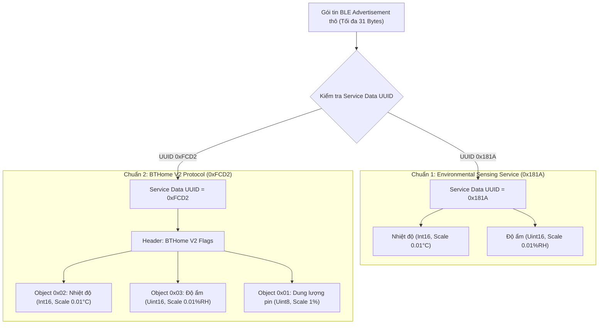

# Hợp Đồng Dữ Liệu và Lược Đồ Chi Tiết (Data Contracts & Schemas Specification)

- **Dự án:** Smart Clock as Edge IoT Gateway
- **Tài liệu tham chiếu gốc (Frozen):** [fsd-smart-clock-gateway.md](file:///home/chien/ai-workspace/qwen-test/fsd-smart-clock-gateway.md)
- **Mã nguồn thực thi:** [firmware/main/event_bus.h](file:///home/chien/ai-workspace/qwen-test/firmware/main/event_bus.h), [firmware/main/sd_logger.h](file:///home/chien/ai-workspace/qwen-test/firmware/main/sd_logger.h), [tests/host/test_sync_queue.py](file:///home/chien/ai-workspace/qwen-test/tests/host/test_sync_queue.py)
- **Truy vết yêu cầu kỹ thuật:** `Traces to: FR-EVT-01 / FR-BLE-01 / FR-MQTT-01 / FR-ST-01 / FR-SD-01 / FR-SD-02 / FR-CFG-01 / FR-CFG-02`

---

## 1. Đặc Tả Gói Tin Quảng Bá Vô Tuyến BLE (BLE Advertisement Packet Specification)

Phân hệ BLE Telemetry Adapter tiếp nhận dữ liệu đo lường môi trường thông qua hai khuôn dạng gói tin quảng bá tiêu chuẩn không cần kết nối:



### 1.1 Cấu Trúc Byte Chuẩn Environmental Sensing Service (UUID `0x181A`)
Phổ biến trên firmware tùy biến (Custom Firmware ATC/pvvx) của cảm biến nhiệt ẩm Xiaomi Mijia LYWSD03MMC:

| Offset Byte | Độ Dài | Tên Trường | Kiểu Dữ Liệu | Thứ Tự Byte | Mô Tả Kỹ Thuật |
|:---:|:---:|---|---|:---:|---|
| `0x00` | 1 Byte | AD Length | `uint8_t` | - | Chiều dài khối dữ liệu AD Structure. |
| `0x01` | 1 Byte | AD Type | `uint8_t` | - | `0x16` (Service Data - 16-bit UUID). |
| `0x02..0x03` | 2 Bytes | Service UUID | `uint16_t` | Little-Endian | Giá trị cố định `0x181A` (GATT ESS UUID). |
| `0x04..0x05` | 2 Bytes | Temperature | `int16_t` | Little-Endian | Nhiệt độ có dấu, bước chia $0.01^\circ\text{C}$ (VD: `0x0A28` = $2600 \rightarrow 26.00^\circ\text{C}$). |
| `0x06..0x07` | 2 Bytes | Humidity | `uint16_t` | Little-Endian | Độ ẩm tương đối, bước chia $0.01\%\text{RH}$ (VD: `0x157C` = $5500 \rightarrow 55.00\%\text{RH}$). |
| `0x08` | 1 Byte | Battery Level | `uint8_t` | - | Dung lượng pin phần trăm: $0 \dots 100\%$. |

### 1.2 Cấu Trúc Byte Giao Thức Mở BTHome V2 (UUID `0xFCD2`)
Chuẩn BTHome mã hóa dạng TLV (Type-Length-Value) linh hoạt:

| Offset Byte | Độ Dài | Tên Trường | Kiểu Dữ Liệu | Mô Tả & Quy Tắc Giải Mã |
|:---:|:---:|---|---|---|
| `0x00` | 1 Byte | AD Length | `uint8_t` | Tổng chiều dài trường AD Service Data. |
| `0x01` | 1 Byte | AD Type | `uint8_t` | `0x16` (Service Data - 16-bit UUID). |
| `0x02..0x03` | 2 Bytes | Service UUID | `uint16_t` LE | `0xFCD2` (Định danh chuẩn đăng ký BTHome V2). |
| `0x04` | 1 Byte | BTHome Header | `uint8_t` | Bit 0: Encrypted (0: Plaintext, 1: AES-CCM), Bits 5..7: Phiên bản = `0x02`. |
| `0x05` | 1 Byte | Object ID 1 | `uint8_t` | `0x02` (Mã cảm biến Nhiệt độ). |
| `0x06..0x07` | 2 Bytes | Data 1 | `int16_t` LE | Giá trị nhiệt độ (Hệ số tỉ lệ: $\times 0.01^\circ\text{C}$). |
| `0x08` | 1 Byte | Object ID 2 | `uint8_t` | `0x03` (Mã cảm biến Độ ẩm). |
| `0x09..0x0A` | 2 Bytes | Data 2 | `uint16_t` LE | Giá trị độ ẩm (Hệ số tỉ lệ: $\times 0.01\%\text{RH}$). |
| `0x0B` | 1 Byte | Object ID 3 | `uint8_t` | `0x01` (Mã trạng thái Pin). |
| `0x0C` | 1 Byte | Data 3 | `uint8_t` | Dung lượng pin $0 \dots 100\%$. |

---

## 2. Mã Định Danh Sự Kiện và Cấu Trúc Dữ Liệu Event Bus

Được chuẩn hóa tại [firmware/main/event_bus.h](file:///home/chien/ai-workspace/qwen-test/firmware/main/event_bus.h), phục vụ làm hợp đồng giao tiếp giữa các phân hệ:

```c
typedef enum {
    EVT_NONE = 0,
    EVT_WIFI_PROVISIONING_STARTED,     // Bắt đầu chế độ SoftAP Captive Portal
    EVT_WIFI_CREDENTIALS_RECEIVED,     // Đã nhận SSID/Mật khẩu từ Web
    EVT_WIFI_CONNECTED,                // Wi-Fi Station kết nối thành công
    EVT_WIFI_LOST,                     // Mất kết nối Wi-Fi
    EVT_BLE_DEVICE_DATA,               // Dữ liệu đo đạc mới từ cảm biến BLE
    EVT_BLE_COMMAND_REQUEST,            // Yêu cầu điều khiển thiết bị BLE
    EVT_DEVICE_OFFLINE_ALERT,          // Cảm biến mất tín hiệu > 60s
    EVT_SD_STATUS_CHANGED,             // Cắm/rút hoặc dung lượng thẻ SD thay đổi
    EVT_CONFIG_RELOAD_REQUEST,         // Yêu cầu nạp lại toàn bộ file JSON
    EVT_MQTT_MESSAGE_RECEIVED,         // Nhận bản tin MQTT thô từ Broker
    EVT_MQTT_CONNECTED,                // MQTT bắt tay thành công
    EVT_MQTT_DISCONNECTED,             // Mất kết nối MQTT Broker
    EVT_DEVICE_COMMAND_REQUEST,        // Lệnh điều khiển rơ-le từ Cloud/CLI
    EVT_RULE_ACTION_REQUEST,           // Lệnh kích hoạt sinh ra từ Rule Engine
    EVT_COMMAND_RESPONSE,              // Phản hồi ACK kết quả thực thi lệnh
    EVT_RELAY_STATE_CHANGED,           // Trạng thái rơ-le vật lý thay đổi
    EVT_SCHEDULE_AUTOMATION_TRIGGERED, // Lịch tự động đến giờ kích hoạt
    EVT_SCHEDULE_ALARM_TRIGGERED,      // Báo thức reo (Buzzer + OLED)
    EVT_SENSOR_VALUE_INVALID,          // Dữ liệu cảm biến lỗi/vượt ngưỡng
    EVT_BUTTON_ALARM_STOP,             // Nút bấm phần cứng tắt còi báo thức
    EVT_BUTTON_SCREEN_NEXT,            // Nút bấm phần cứng chuyển trang OLED
    EVT_DISPLAY_UPDATE_REQUEST,        // Yêu cầu vẽ lại màn hình OLED
    EVT_CONFIG_UPDATED_FROM_CLOUD,     // File cấu hình mới tải từ MQTT Downlink
    EVT_EVENT_LOG_APPENDED,            // Đã ghi nối tiếp 1 sự kiện vào nhật ký
    EVT_SYNC_COMPLETED,                // Hoàn tất đồng bộ bù dữ liệu ngoại tuyến
    EVT_SYSTEM_HEARTBEAT,              // Nhịp tim tổng thể
    EVT_MAX_CODES
} gateway_event_code_t;
```

### 2.1 Các Cấu Trúc Payload Dùng Chung (Shared Payloads)

```c
// Payload sự kiện dữ liệu cảm biến BLE (EVT_BLE_DEVICE_DATA)
typedef struct {
    char     device_id[32]; // Mã thiết bị (vd: "sensor_temp_01")
    union {
        float temperature;  // Nhiệt độ (°C)
        float value;        // Tương thích ngược
    };
    float    humidity;      // Độ ẩm (%RH)
    float    battery_pct;   // Mức pin (0 - 100%)
    bool     valid;         // false -> Rule Engine bắt buộc áp dụng Safe-Default
    uint32_t timestamp;     // Thời gian đọc (UNIX epoch từ RTC)
} ble_telemetry_t;

// Payload trạng thái rơ-le vật lý (EVT_RELAY_STATE_CHANGED)
typedef struct {
    int      relay_id;      // 1: Fan, 2: Heater, 3: Dehumidifier, 4: Aux
    char     device_id[32]; // "relay_1", "relay_2", ...
    bool     state;         // true: ON, false: OFF
    char     reason[32];    // "MANUAL_CMD", "RULE_TRIGGER", "SAFETY_CUTOFF", "SENSOR_OFFLINE"
    uint32_t timestamp;     // UNIX epoch
} relay_state_changed_t;

// Payload yêu cầu điều khiển (EVT_DEVICE_COMMAND_REQUEST)
typedef struct {
    char     command_id[36];       // UUID v4 định danh lệnh duy nhất
    char     target_device_id[32]; // Thiết bị nhận lệnh
    char     action[32];           // "ON", "OFF", "SET:75", "TOGGLE"
    uint32_t ttl_seconds;          // Thời hạn hiệu lực của lệnh (mặc định 60s)
    uint32_t timestamp;            // Epoch thời điểm phát lệnh
} device_command_req_t;

// Payload phản hồi kết quả thực thi lệnh (EVT_COMMAND_RESPONSE)
typedef struct {
    char     command_id[36];       // Khớp chính xác với command_id của yêu cầu
    char     target_device_id[32]; // Thiết bị thực thi
    bool     success;              // true nếu hoàn thành, false nếu có lỗi
    int      error_code;           // 0: OK, 1: TIMEOUT, 2: INVALID_CMD, 3: EXPIRED
    char     message[64];          // Thông điệp kết quả
    uint32_t executed_at;          // Thời điểm thực thi xong
} command_ack_t;

// Payload hành động do Rule Engine kích hoạt (EVT_RULE_ACTION_REQUEST)
typedef struct {
    char     command_id[36];       // Tự sinh UUID cho action
    char     target_device_id[32]; // Thiết bị mục tiêu
    union {
        char command[32];          // "ON", "OFF", "SET:75"
        char action_command[32];
    };
    uint32_t timestamp;            // Epoch
    int      source_rule_id;       // ID của luật phát sinh lệnh
} rule_action_request_t;
```

> [!NOTE]
> `/* ponytail: Toàn bộ payload trên Event Bus sử dụng cấu trúc phẳng C POD (Plain Old Data) với mảng chuỗi cố định kích thước (16..36 bytes), không chứa con trỏ động lồng nhau (no nested heap pointers). Nhờ vậy, Dispatcher chỉ cần 1 lệnh free(evt.data) duy nhất là giải phóng sạch 100% bộ nhớ. */`

---

## 3. Lược Đồ JSON Hệ Thống Tệp Cục Bộ (Local JSON Schemas)

Các file cấu hình được lưu trên phân vùng LittleFS `/storage/` (tương thích SPIFFS):

### 3.1 Cấu Hình Tổng Thể: `/storage/config.json`
```json
{
  "$schema": "http://json-schema.org/draft-07/schema#",
  "title": "GatewayConfig",
  "type": "object",
  "required": ["gateway_id", "mqtt_broker_uri", "timezone"],
  "properties": {
    "gateway_id": { "type": "string", "pattern": "^[a-zA-Z0-9_-]{3,32}$" },
    "mqtt_broker_uri": { "type": "string", "format": "uri" },
    "mqtt_port": { "type": "integer", "default": 1883 },
    "mqtt_client_id": { "type": "string" },
    "timezone": { "type": "string", "default": "ICT-7" },
    "ntp_server": { "type": "string", "default": "pool.ntp.org" },
    "ble_whitelist": {
      "type": "array",
      "items": {
        "type": "object",
        "required": ["mac", "device_id"],
        "properties": {
          "mac": { "type": "string", "pattern": "^([0-9A-Fa-f]{2}:){5}[0-9A-Fa-f]{2}$" },
          "device_id": { "type": "string" },
          "type": { "type": "string", "enum": ["environmental", "button", "beacon"] }
        }
      }
    }
  }
}
```

### 3.2 Luật Tự Động Hóa Cục Bộ: `/storage/rules.json`
```json
{
  "$schema": "http://json-schema.org/draft-07/schema#",
  "title": "AutomationRules",
  "type": "array",
  "items": {
    "type": "object",
    "required": ["rule_id", "name", "sensor_id", "condition", "operator", "threshold", "action_device_id", "action_command", "enabled"],
    "properties": {
      "rule_id": { "type": "integer" },
      "name": { "type": "string", "maxLength": 32 },
      "sensor_id": { "type": "string", "maxLength": 32 },
      "condition": { "type": "string", "enum": ["temperature", "humidity", "battery"] },
      "operator": { "type": "string", "enum": [">", "<", ">=", "<=", "=="] },
      "threshold": { "type": "number" },
      "hysteresis": { "type": "number", "default": 1.5 },
      "action_device_id": { "type": "string", "maxLength": 32 },
      "action_command": { "type": "string", "enum": ["ON", "OFF", "TOGGLE"] },
      "lockout_seconds": { "type": "integer", "default": 300 },
      "enabled": { "type": "boolean" }
    }
  }
}
```

### 3.3 Lịch Biểu và Báo Thức: `/storage/schedule.json`
```json
{
  "$schema": "http://json-schema.org/draft-07/schema#",
  "title": "LocalSchedules",
  "type": "array",
  "items": {
    "type": "object",
    "required": ["id", "type", "time", "action_device_id", "action_command", "enabled"],
    "properties": {
      "id": { "type": "integer" },
      "name": { "type": "string", "maxLength": 32 },
      "type": { "type": "string", "enum": ["alarm", "automation"] },
      "time": { "type": "string", "pattern": "^([01][0-9]|2[0-3]):[0-5][0-9]$" },
      "repeat_days": {
        "type": "array",
        "items": { "type": "integer", "minimum": 0, "maximum": 6 },
        "description": "0: Chủ Nhật, 1: Thứ Hai, ..., 6: Thứ Bảy"
      },
      "one_time_date": { "type": "string", "format": "date" },
      "action_device_id": { "type": "string" },
      "action_command": { "type": "string" },
      "enabled": { "type": "boolean" }
    }
  }
}
```

### 3.4 Nhật Ký Sự Kiện: `/storage/event_log.json` (Newline-Delimited JSON)
Mỗi dòng là một đối tượng JSON độc lập:
```json
{"timestamp": 1726800000, "event": "RELAY_STATE_CHANGED", "device_id": "relay_1", "state": true, "reason": "RULE_TRIGGER"}
{"timestamp": 1726800005, "event": "ALARM_STOPPED", "source": "BUTTON_GPIO_4", "duration_s": 12}
```

---

## 4. Hợp Đồng Giao Thức MQTT (Topics & Wire Payloads)

Toàn bộ thông điệp sử dụng chuẩn mã hóa chuỗi JSON UTF-8:

### 4.1 Danh Mục Topics Chuẩn Hóa
- `gateway/{gateway_id}/status`: Trạng thái sống còn (Retained, LWT).
- `gateway/{gateway_id}/device/{device_id}/telemetry`: Đo lường cảm biến theo thời gian thực (QoS 1).
- `gateway/{gateway_id}/device/{device_id}/command`: Lệnh điều khiển từ Cloud xuống thiết bị (QoS 1).
- `gateway/{gateway_id}/device/{device_id}/command/ack`: Phản hồi kết quả thực thi lệnh lên Cloud (QoS 1).
- `gateway/{gateway_id}/telemetry/batch`: Dữ liệu bù lưu trữ ngoại tuyến từ thẻ SD (QoS 1).
- `gateway/{gateway_id}/config/schedule`: Đồng bộ lịch biểu từ Cloud xuống (QoS 1, Retained).
- `gateway/{gateway_id}/events`: Dòng sự kiện kiểm toán hệ thống (Audit Events, QoS 1).

### 4.2 Cấu Trúc Payloads Chi Tiết

#### Telemetry Uplink:
```json
{
  "device_id": "ble_sensor_01",
  "temperature": 28.5,
  "humidity": 65.2,
  "battery_pct": 92.0,
  "valid": true,
  "timestamp": 1726800100
}
```

#### Downlink Command:
```json
{
  "command_id": "550e8400-e29b-41d4-a716-446655440000",
  "target_device_id": "relay_1",
  "action": "ON",
  "ttl_seconds": 60,
  "source": "web_app",
  "timestamp": 1726800100
}
```

#### Command ACK Uplink:
```json
{
  "command_id": "550e8400-e29b-41d4-a716-446655440000",
  "target_device_id": "relay_1",
  "success": true,
  "error_code": 0,
  "message": "Relay 1 switched ON with Fan interlock confirmed",
  "executed_at": 1726800101
}
```

#### Batch Backfill Uplink (`gateway/{id}/telemetry/batch`):
```json
{
  "batch_id": "b-1726800500",
  "count": 2,
  "records": [
    {
      "timestamp": 1726799000,
      "record_type": 1,
      "device_id": "ble_sensor_01",
      "value": 27.8
    },
    {
      "timestamp": 1726799010,
      "record_type": 1,
      "device_id": "ble_sensor_01",
      "value": 27.9
    }
  ]
}
```

---

## 5. Định Dạng Nhị Phân Hàng Đợi Ngoại Tuyến (`sync_queue.bin`)

Hàng đợi lưu trữ và chuyển tiếp (Store-and-Forward Sync Queue) được lưu tại `/sdcard/data/sync_queue.bin`.

### 5.1 Cấu Trúc Nhị Phân Chuẩn Cố Định (Standard Layout - Đã Kiểm Thử)
Khớp 100% với [firmware/main/sd_logger.h](file:///home/chien/ai-workspace/qwen-test/firmware/main/sd_logger.h) và kiểm thử máy chủ [tests/host/test_sync_queue.py](file:///home/chien/ai-workspace/qwen-test/tests/host/test_sync_queue.py):

#### Cấu Trúc File Header (Đúng 24 Bytes, Chuẩn `<IIIIII`):
```
 0                   1                   2                   3
 0 1 2 3 4 5 6 7 8 9 0 1 2 3 4 5 6 7 8 9 0 1 2 3 4 5 6 7 8 9 0 1
+-+-+-+-+-+-+-+-+-+-+-+-+-+-+-+-+-+-+-+-+-+-+-+-+-+-+-+-+-+-+-+-+
|                    Magic: 0x53594E43 ("SYNC")                 |
+-+-+-+-+-+-+-+-+-+-+-+-+-+-+-+-+-+-+-+-+-+-+-+-+-+-+-+-+-+-+-+-+
|                  write_offset (Byte con trỏ ghi)               |
+-+-+-+-+-+-+-+-+-+-+-+-+-+-+-+-+-+-+-+-+-+-+-+-+-+-+-+-+-+-+-+-+
|                  read_offset (Byte con trỏ đã ACK)            |
+-+-+-+-+-+-+-+-+-+-+-+-+-+-+-+-+-+-+-+-+-+-+-+-+-+-+-+-+-+-+-+-+
|                  total_records (Tổng số bản ghi)              |
+-+-+-+-+-+-+-+-+-+-+-+-+-+-+-+-+-+-+-+-+-+-+-+-+-+-+-+-+-+-+-+-+
|                  unacked_count (Số bản ghi chờ gửi)           |
+-+-+-+-+-+-+-+-+-+-+-+-+-+-+-+-+-+-+-+-+-+-+-+-+-+-+-+-+-+-+-+-+
|                  crc32 (Checksum bảo vệ 20 bytes đầu)        |
+-+-+-+-+-+-+-+-+-+-+-+-+-+-+-+-+-+-+-+-+-+-+-+-+-+-+-+-+-+-+-+-+
```

```c
typedef struct __attribute__((packed)) {
    uint32_t magic;          // 4 Bytes: 0x53594E43 ("SYNC")
    uint32_t write_offset;   // 4 Bytes: Vị trí byte bắt đầu ghi bản ghi kế
    uint32_t read_offset;    // 4 Bytes: Vị trí byte bản ghi chưa được Cloud ACK
    uint32_t total_records;  // 4 Bytes: Tổng số bản ghi đã ghi vào file
    uint32_t unacked_count;  // 4 Bytes: Số lượng bản ghi còn tồn đọng
    uint32_t crc32;          // 4 Bytes: Checksum CRC32 tính trên 20 bytes đầu
} sync_queue_header_t;       // Kích thước chuẩn cố định: 24 Bytes
```

#### Cấu Trúc Record (Đúng 32 Bytes, Chuẩn `<IBBH16sfI`):
```
 0                   1                   2                   3
 0 1 2 3 4 5 6 7 8 9 0 1 2 3 4 5 6 7 8 9 0 1 2 3 4 5 6 7 8 9 0 1
+-+-+-+-+-+-+-+-+-+-+-+-+-+-+-+-+-+-+-+-+-+-+-+-+-+-+-+-+-+-+-+-+
|                      timestamp (4 Bytes Epoch)                |
+-+-+-+-+-+-+-+-+-+-+-+-+-+-+-+-+-+-+-+-+-+-+-+-+-+-+-+-+-+-+-+-+
|  type (0x01)  |  flags (QoS)  |       reserved (0x0000)       |
+-+-+-+-+-+-+-+-+-+-+-+-+-+-+-+-+-+-+-+-+-+-+-+-+-+-+-+-+-+-+-+-+
|                                                               |
+                       device_id (16 Bytes)                    +
|                                                               |
+-+-+-+-+-+-+-+-+-+-+-+-+-+-+-+-+-+-+-+-+-+-+-+-+-+-+-+-+-+-+-+-+
|                    value (4 Bytes IEEE 754 float)             |
+-+-+-+-+-+-+-+-+-+-+-+-+-+-+-+-+-+-+-+-+-+-+-+-+-+-+-+-+-+-+-+-+
|                  crc32 (Checksum bảo vệ 28 bytes đầu)        |
+-+-+-+-+-+-+-+-+-+-+-+-+-+-+-+-+-+-+-+-+-+-+-+-+-+-+-+-+-+-+-+-+
```

```c
typedef struct __attribute__((packed)) {
    uint32_t timestamp;      // 4 Bytes: Unix epoch timestamp
    uint8_t  record_type;    // 1 Byte: 0x01=telemetry, 0x02=event_log, 0x03=command_ack
    uint8_t  flags;          // 1 Byte: Bit 0: QoS1, Bit 1: encrypted
    uint16_t reserved;       // 2 Bytes: Căn chỉnh bộ nhớ (Padding = 0)
    char     device_id[16];  // 16 Bytes: Định danh thiết bị (Null-terminated)
    float    value;          // 4 Bytes: Giá trị đo telemetry (IEEE 754 float)
    uint32_t crc32;          // 4 Bytes: Checksum CRC32 tính trên 28 bytes đầu
} sync_queue_record_t;       // Kích thước chuẩn cố định: 32 Bytes
```

### 5.2 Phân Tích Hiệu Suất Căn Chỉnh Sector Vật Lý (Physical Sector Alignment Audit)
- **Kích thước Sector chuẩn MicroSD:** 512 Bytes.
- **Tính toán dung lượng và ranh giới:**
  $$\frac{512\,\text{Bytes/Sector}}{32\,\text{Bytes/Record}} = 16\,\text{bản ghi / Sector (Chia hết 100\%, số dư = 0)}$$
- **Kết luận thẩm định Ponytail:**
  Bản ghi nhị phân chuẩn 32-byte (`sync_queue_record_t`) tự nhiên khớp hoàn hảo vào sector 512-byte vật lý: đúng 16 bản ghi nằm trọn vẹn trên mỗi sector, loại bỏ hoàn toàn hiện tượng bản ghi nằm vắt qua hai sector (Sector boundary crossing).
- `/* ponytail: Phản biện loại bỏ triệt để đề xuất mở rộng 64-byte (Extended 64B): Bản ghi 32-byte đã chia hết hoàn hảo cho sector 512B (16 records/sector). Mở rộng lên 64B là hành vi Data Bloat vô nghĩa, làm lãng phí 50% dung lượng thẻ nhớ vào padding rác, giảm một nửa dung lượng hàng đợi (từ 100.000 xuống 50.000 bản ghi) và tăng gấp đôi thời gian truyền SPI bus. */`

### 5.3 Thuật Toán Kiểm Định Toàn Vẹn CRC32
- Sử dụng đa thức chuẩn IEEE 802.3 Ethernet:
  $$P(x) = x^{32} + x^{26} + x^{23} + x^{22} + x^{16} + x^{12} + x^{11} + x^{10} + x^8 + x^7 + x^5 + x^4 + x^2 + x + 1$$
  (Mã hexa chuẩn: `0xEDB88320` phản xạ, giá trị khởi tạo `0xFFFFFFFF`).
- Trước khi thực hiện gửi bù bản tin, `sd_log_task` tính lại CRC32 của 28 bytes đầu và so sánh với trường `crc32` lưu ở cuối bản ghi. Nếu không khớp, bản ghi bị coi là hỏng do sụt áp và bị bỏ qua, bảo đảm dữ liệu gửi lên Backend luôn nguyên vẹn.
