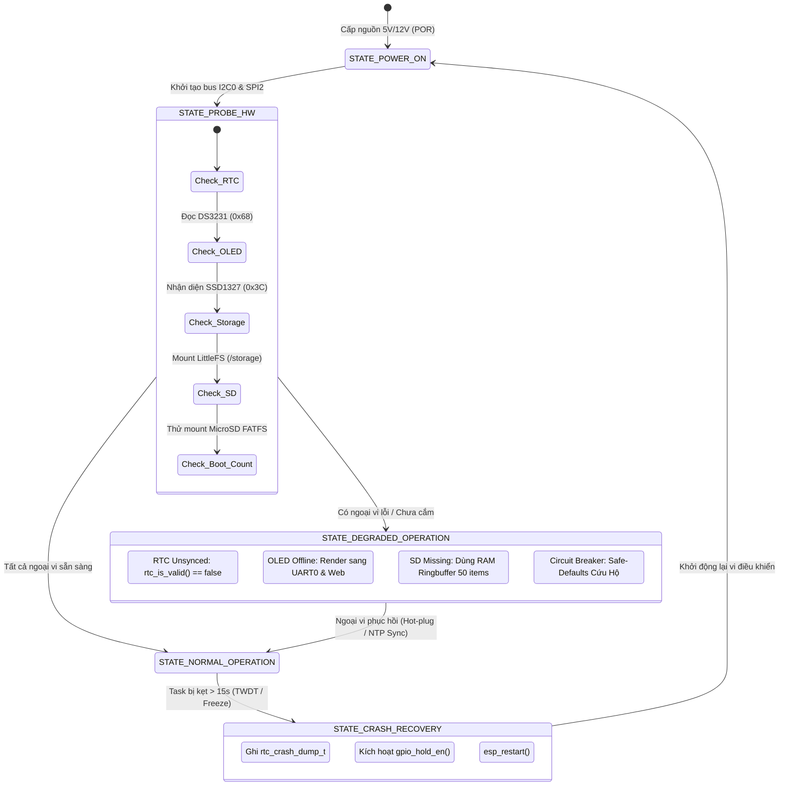
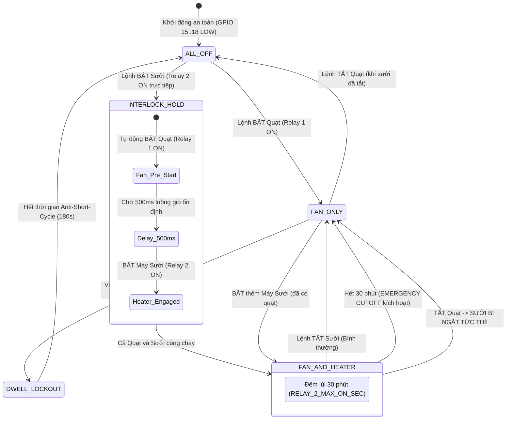
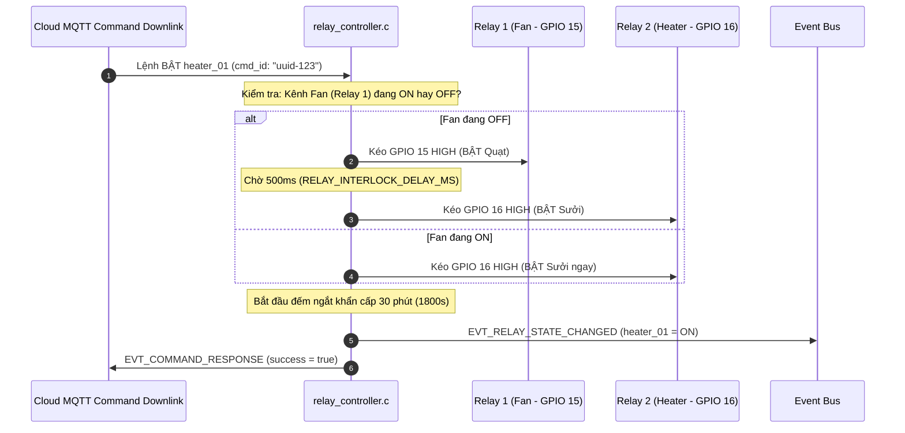
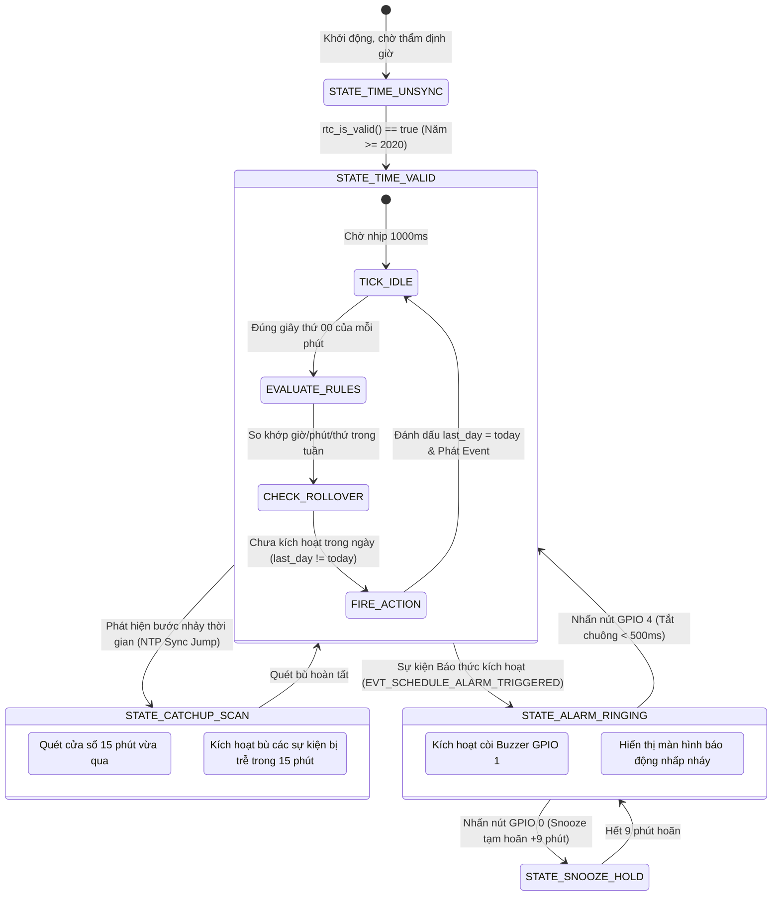

# Biểu Đồ Trạng Thái và Kiến Trúc An Toàn Dự Phòng (State Machines & Safety Architecture)

- **Dự án:** Smart Clock as Edge IoT Gateway
- **Tài liệu tham chiếu gốc (Frozen):** [fsd-smart-clock-gateway.md](file:///home/chien/ai-workspace/qwen-test/fsd-smart-clock-gateway.md)
- **Mã nguồn thực thi:** [firmware/main/relay_controller.c](file:///home/chien/ai-workspace/qwen-test/firmware/main/relay_controller.c), [firmware/main/rule_engine.c](file:///home/chien/ai-workspace/qwen-test/firmware/main/rule_engine.c), [firmware/main/scheduler.c](file:///home/chien/ai-workspace/qwen-test/firmware/main/scheduler.c), [firmware/main/uplink.c](file:///home/chien/ai-workspace/qwen-test/firmware/main/uplink.c), [firmware/main/supervisor.c](file:///home/chien/ai-workspace/qwen-test/firmware/main/supervisor.c)
- **Truy vết yêu cầu kỹ thuật:** `Traces to: FR-RELAY-01 / FR-RULE-01 / FR-SCHED-01 / FR-SUP-01 / FR-SUP-02 / FR-MQTT-01 / FR-SD-02 / FR-ST-01`

---

## 1. Biểu Đồ Trạng Thái Khởi Động và Chế Độ Tự Thích Ứng Suy Giảm (Boot & Degraded Mode)

Trình điều khiển hệ thống quản lý các trạng thái từ lúc cấp nguồn, thẩm định phần cứng đến khi đi vào chế độ hoạt động bình thường hoặc chế độ suy giảm chức năng an toàn (Graceful Degradation):



### 1.1 Chi Tiết Các Chuyển Trạng Thái và Điều Kiện Rẽ Nhánh
1. **Từ `STATE_PROBE_HW` sang `STATE_DEGRADED_OPERATION`:**
   - **Lỗi RTC DS3231:** Trạng thái `D_RTC` được kích hoạt. Lịch biểu bị tạm giữ, hệ thống kích hoạt chế độ đếm thời gian tương đối bằng FreeRTOS Tick và gửi tín hiệu ưu tiên yêu cầu đồng bộ NTP khi có Wi-Fi.
   - **Lỗi Thẻ Nhớ SD:** Trạng thái `D_SD` được kích hoạt. Hàng đợi chuyển sang bộ đệm RAM (RAM Buffer dung lượng 50 bản tin). Cứ mỗi 10 giây, một tác vụ nền thử mount lại thẻ nhớ để tự động nhận dạng thẻ khi người dùng cắm vào mà không cần tắt nguồn (Hot-plug auto-mount).
   - **Phát hiện Boot Loop ($\ge 3$ lần reset trong 60s):** Kích hoạt `D_CIRCUIT`. Cầu dao an toàn (Circuit Breaker) ngắt việc tải file cấu hình bị hỏng, bật mạng SoftAP cứu hộ và console UART0.

---

## 2. Vòng Đời Kết Nối Mạng và Đồng Bộ Bù (Network & Backfill Lifecycle)

Quản lý chuyển tiếp mượt mà giữa chế độ hoạt động hoàn toàn độc lập (Offline Local Mode) và chế độ trực tuyến (Online Cloud Mode):

```mermaid
stateDiagram-v2
    [*] --> STATE_OFFLINE_LOCAL : Boot hoàn tất / Không có Internet
    STATE_OFFLINE_LOCAL --> STATE_WIFI_CONNECTING : Đang kết nối AP gia đình
    STATE_WIFI_CONNECTING --> STATE_OFFLINE_LOCAL : Kết nối Wi-Fi thất bại
    STATE_WIFI_CONNECTING --> STATE_WIFI_CONNECTED : Nhận IP thành công (EVT_WIFI_CONNECTED)

    STATE_WIFI_CONNECTED --> STATE_NTP_SYNC : Đồng bộ giờ SNTP (esp_sntp)
    STATE_NTP_SYNC --> STATE_MQTT_CONNECTING : Giờ chuẩn xác, kết nối Broker

    state STATE_MQTT_CONNECTING {
        [*] --> Try_Connect
        Try_Connect --> Backoff_Delay : Lỗi kết nối Broker
        Backoff_Delay --> Try_Connect : Hết thời gian chờ (1s..60s + Jitter)
    }

    STATE_MQTT_CONNECTING --> STATE_ONLINE_SYNCING : MQTT bắt tay thành công (EVT_MQTT_CONNECTED)
    STATE_ONLINE_SYNCING --> STATE_ONLINE_BACKFILLING : Tải xong config/schedule
    
    state STATE_ONLINE_BACKFILLING {
        Read_Batch : Đọc lô 20 records từ sync_queue.bin
        Send_Batch : Publish topic telemetry/batch (QoS 1)
        Wait_Ack : Chờ PUBACK từ Broker
        Update_Offset : Cập nhật read_offset và f_sync()
        Read_Batch --> Send_Batch --> Wait_Ack --> Update_Offset
    }

    STATE_ONLINE_BACKFILLING --> STATE_ONLINE_NORMAL : Hàng đợi rỗng (read_offset == write_offset)
    STATE_ONLINE_NORMAL --> STATE_OFFLINE_LOCAL : Mất Wi-Fi hoặc Broker ngắt (EVT_MQTT_DISCONNECTED)
```

### 2.1 Các Tiêu Chí và Tham Số Vận Hành
- **Tốc độ gửi bù (Backfill Rate Limiter):** Mỗi batch gồm tối đa **20 bản tin**. Khoảng nghỉ giữa hai đợt publish liên tiếp là **100ms** (tương đương tốc độ điều tiết từ **20 đến 50 bản tin/giây**). Tốc độ này giúp đường truyền không bị nghẽn và nhường băng thông cho các gói tin điều khiển khẩn cấp.
- **Tiêu chí hoàn tất:** Quá trình gửi bù kết thúc khi con trỏ `read_offset` bắt kịp con trỏ `write_offset`. Sau đó hệ thống phát ra sự kiện `EVT_SYNC_COMPLETED`.
- `/* ponytail: Tối ưu hóa bộ đệm gửi bù (Backfill): Sử dụng bộ đệm stack tĩnh 20 records (20 x 32 = 640 Bytes), không cấp phát heap động trong suốt vòng đời gửi bù. Tốc độ điều tiết 100ms/batch bảo vệ socket lwIP không bị tràn outbox mà không cần cơ chế flow-control phức tạp. */`

---

## 3. Biểu Đồ Bảo Vệ Rơ-le và Khóa Liên Động (Relay Protection & Interlock)

Bảo vệ an toàn cơ cấu chấp hành, triệt tiêu nguy cơ chập cháy điện trở nhiệt và bảo vệ tiếp điểm rơ-le:



### 3.1 Quy Trình Xử Lý Lệnh Điều Khiển Có Khóa Liên Động



---

## 4. Vòng Đời Lịch Biểu Cục Bộ và Đồng Bộ Thời Gian (Scheduler & Time Sync)

Đảm bảo báo thức và các mốc tự động hóa được kích hoạt chính xác, không trùng lặp và không bỏ sót sự kiện khi giờ bị thay đổi:



---

## 5. Ma Trận An Toàn và Ứng Phó Sự Cố (Safe-Default Matrix)

Hệ thống thiết lập ma trận ứng phó sự cố toàn diện cho mọi tình huống bất thường trong vận hành thực tế:

| Tình Huống Sự Cố | Phân Hệ Phát Hiện | Ngưỡng Kích Hoạt | Hành Động An Toàn Tức Thì (Immediate Action) | Trạng Thái Cơ Cấu Chấp Hành | Cảnh Báo Phản Hồi | Cơ Chế Tự Phục Hồi |
|---|---|---|---|---|---|---|
| **Mất tín hiệu cảm biến BLE** | `ble_adapter` | Không nhận được beacon trong **60 giây** | Gán `valid = false`. Chặn toàn bộ luật tự động liên quan. | **Relay 2 (Sưởi): TẮT NGAY LẬP TỨC!**<br>Relay 1 (Quạt): Giữ BẬT an toàn.<br>Relay 3 (Hút ẩm): TẮT. | Badge cảm biến nhấp nháy lỗi trên OLED; phát `EVT_DEVICE_OFFLINE_ALERT`. | Tự phục hồi ngay khi nhận lại gói tin quảng bá hợp lệ đầu tiên. |
| **Gói tin BLE sai lệch / Nhiễu sóng** | Driver NimBLE | Lỗi CRC hoặc sai cấu trúc UUID 0x181A | Hủy gói tin tại tầng driver, không cấp phát heap. | Giữ nguyên trạng thái hiện tại. | Không log spam, bảo vệ Event Bus. | Chờ chu kỳ beacon tiếp theo (tự phát lại sau 1..5s). |
| **Mất mạng Wi-Fi / Mất Internet** | `uplink_task` | Ngắt kết nối Station hoặc DNS fail | Chuyển luồng telemetry sang ghi file nhị phân `sync_queue.bin` trên MicroSD. | Duy trì 100% tự động hóa cục bộ và chuông báo thức. | Badge Wi-Fi chuyển sang trạng thái Offline trên OLED. | Tự động kết nối lại và kích hoạt tiến trình Backfill Batch khi có mạng. |
| **Kẹt / Treo Broker MQTT** | `mqtt_adapter` | Ping timeout hoặc TCP socket reset | Kích hoạt bộ đếm Exponential Backoff (1s $\dots$ 60s có Jitter). | Cho phép điều khiển qua nút bấm local và Serial CLI. | Badge Cloud tắt. | Tái kết nối ngầm, phát lại LWT khi thành công. |
| **Thẻ nhớ MicroSD bị rút / hỏng** | `sd_log_task` | Lỗi I/O SPI hoặc mount thất bại | Kích hoạt RAM Ringbuffer Fallback (lưu đệm tối đa 50 bản tin mới nhất). | Không ảnh hưởng đến điều khiển rơ-le. | Badge SD báo lỗi gạch chéo trên màn hình OLED. | Định kỳ mỗi 10 giây gọi mount lại để tự nhận diện khi cắm thẻ mới. |
| **Đĩa thẻ nhớ đầy (< 50MB trống)** | `sd_log_task` | `f_getfree` báo dung lượng trống < 50MB | Kích hoạt thuật toán thanh lý FIFO: Tự động xóa các file CSV cũ nhất trong `/sdcard/data/telemetry/`. | Duy trì hoạt động ghi file bình thường. | Ghi cảnh báo `DISK_LOW_SPACE` vào audit log. | Giải phóng bộ nhớ, duy trì tối thiểu 10% dung lượng trống. |
| **Mất điện nguồn đột ngột (Power Loss)** | Cấp phần cứng | Sụt áp đường nguồn 5V/12V | Pin CR2032 duy trì dao động TCXO của DS3231. Rơ-le tự động nhả tiếp điểm do cuộn hút mất điện. | Toàn bộ rơ-le trở về trạng thái ngắt vật lý an toàn. | - | Lần boot kế tiếp, LittleFS và file `sync_queue.bin` còn nguyên nhờ `f_sync()`. |
| **Task hệ thống bị treo / Deadlock** | `supervisor` | Không nhận được nhịp tim task trong **15 giây** | Ghi thông số sự cố `rtc_crash_dump_t` vào RTC Slow Memory. Kích hoạt `gpio_hold_en()` và `esp_restart()`. | Giữ nguyên trạng thái GPIO rơ-le qua quá trình reset (chống chattering). | In crash dump ra console UART0 ngay sau khi khởi động lại. | Chip tự reboot sau 2.5s, nạp lại trạng thái an toàn từ cấu hình. |
| **Lặp khởi động liên tiếp (Boot Loop)** | `supervisor` | $\ge 3$ lần crash liên tiếp trong vòng **60 giây** | Kích hoạt Cầu dao an toàn (Circuit Breaker): Chuyển sang **Safe-Defaults Mode**, bỏ qua file JSON lỗi. | Kéo toàn bộ 4 rơ-le về mức LOW (TẮT HẾT). | Màn hình OLED hiển thị `SYSTEM RESCUE MODE`. Mở SoftAP & CLI. | Kỹ thuật viên kết nối Web Portal hoặc CLI cứu hộ nạp lại config. |

> [!NOTE]
> `/* ponytail: Ma trận Safe-Default tận dụng trực tiếp các giá trị hằng số trong mã nguồn C thay vì duy trì các phân vùng cấu hình bóng (shadow config partitions); bảo đảm hệ thống luôn khởi động an toàn ngay cả khi filesystem bị hỏng hoàn toàn. */`
